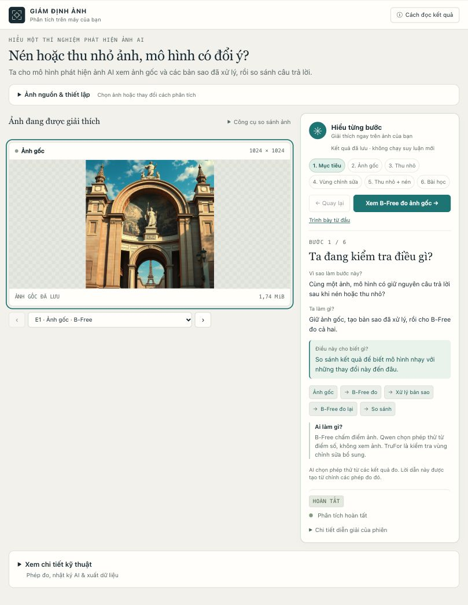
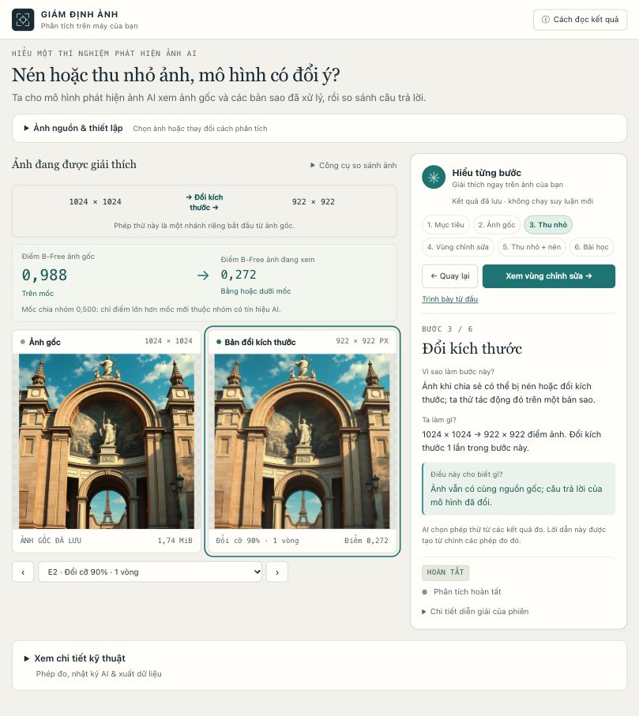
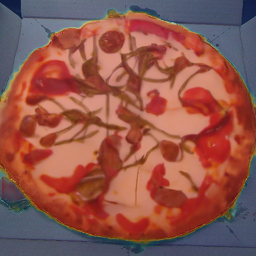
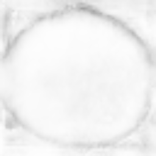

# AI Image Forensics Assistant

[Tiếng Việt (default)](README.md) · **English**

**Does an AI image detector change its answer when an image is compressed or resized?**

AI Image Forensics Assistant is a local research prototype for comparing detector responses on an original image and its JPEG-compressed or resized copies. Its Vietnamese interface explains each step, displays measured evidence, and exports records for inspection.

> Detector scores are research signals, not verdicts about whether an image is real or fake. A stable score across transformations does not verify an image's origin.



*Interface screenshot showing saved results. Reviewing these steps does not run new inference.*

## What you can do

- **Compare originals and processed copies:** test JPEG compression, resizing, or both, using cumulative processing and matched-size single-pass controls.
- **Measure AI-generation evidence with B-Free:** retain raw logits, sigmoid scores, and changes across tests.
- **Inspect regions with TruFor:** view manipulation anomalies, localization reliability, and overlays.
- **Let a local model choose tests:** Qwen2.5-1.5B-Instruct selects allowed tools within a fixed budget.
- **Export evidence:** JSON, CSV, dimensions, bytes, transformation history, MSE, and PSNR.

The repository includes the manifest, protocol, and measured results of a frozen **320-image research pilot**, plus an FFT/DCT classifier baseline fitted only on training originals. Dataset images and model weights are not shipped in the repository.

## Run the application

### On the configured development machine

The isolated Python environment and models are installed on the original development machine. On any checkout, run `python scripts/doctor.py` first to check which pieces are present. Then double-click `start.command`, or run from the project directory:

```bash
bash scripts/start-with-models.sh
```

Open **http://127.0.0.1:8765**. To use port 8766, append `--port 8766` to the startup command and open that address.

Interactive B-Free and TruFor adapters default to CPU. The local planner automatically uses Apple MPS when available. The first analysis loads models; large regional scans can take several minutes.

### On a new machine

On Linux or macOS, run `bash scripts/bootstrap.sh` to create `.venv` and check the environment. Or install the basic transformation and distortion-measurement workflow by hand:

```bash
python3 -m venv .venv
source .venv/bin/activate
python -m pip install -r requirements.txt
python scripts/doctor.py
python -m forensics.server
```

On Windows, run `powershell -ExecutionPolicy Bypass -File scripts\bootstrap.ps1`, then `run.bat`. See the [platform matrix](docs/PLATFORMS.md) and pinned inference packages in `requirements-models.txt`. The doctor lists available images, model directories, run artifacts, and missing components. The recorded demo serves from `output/model-verification/` and is read-only.

Follow [MODEL_SETUP.md](docs/MODEL_SETUP.md) for B-Free, TruFor, and planner inference. Without configured models, transformations and distortion measurements still work, but detector scores remain missing. The application does not substitute heuristic scores or fabricated maps.

The server binds only to the local machine. Images are processed locally by default; configuring a Modal endpoint sends images to that service for inference. Uploaded images and generated outputs stay in `output/runs/`; delete a run directory to remove its saved source and derivatives.

## Try an investigation

1. **Choose an image** in JPEG, PNG, or WebP format. Limits: 20 MiB, 20 megapixels, and at least 16 pixels per dimension. The backend also reads single-frame BMP/TIFF.
2. Select **Phân tích ảnh** (Analyze image). The default **AI chọn phép thử** mode measures the original with B-Free, then chooses further tests from recorded observations. The default budget is four model-tool calls, including the original measurement.
3. Read **Hiểu từng bước** (Understand each step) for the purpose, action, and meaning of each measurement. Back and Next navigation select the corresponding evidence.
4. For a manual experiment, open **Thiết lập nâng cao → Tự chọn thiết lập** (Advanced settings → Choose settings). Set JPEG quality 50–100, scale 0.5–1.0, and 1–5 rounds; choose operation order when combining transformations.
5. Open **Xem chi tiết kỹ thuật** (Technical details) to inspect records and export JSON/CSV. An optional TruFor regional scan is interpreted separately from B-Free scores.

Adaptive tests each branch from the original. Manual mode also supports cumulative processing across rounds. Cancellation stops between tool calls. See [agent design](docs/AGENT_DESIGN.md).



*In this saved example, resizing from 1024 × 1024 to 922 × 922 changes the B-Free score from approximately 0.988 to 0.272, crossing 0.5. This is one illustrative case, not a general accuracy result.*

## Interpret the evidence

| Component | What it measures | Interpretation |
| --- | --- | --- |
| B-Free | AI-generation evidence | Displays sigmoid of the raw logit on a 0–1 scale; this is not a calibrated probability that an image is fake. |
| TruFor | Manipulation anomalies, localization reliability, and an image forgery score | Highlighted regions do not prove AI generation. These outputs are never merged with B-Free into one confidence number. |
| MSE / PSNR | Distortion after transformation | Measures image differences, not AI origin. |
| Score trajectory | Sensitivity to the tested operations | Both changes and stability must be interpreted within the experiment's scope. |

The default B-Free positive decision is strictly `score > 0.5`, equivalent to the official logit rule `> 0`. A score of exactly 0.5 is not above the threshold.

### Regional evidence example

| Anomaly overlay | Localization reliability |
| --- | --- |
|  |  |

*Actual inference on an official 256 × 256 demo image. Brighter reliability regions indicate greater localization reliability. These images illustrate TruFor outputs; they do not establish AI generation. Record: [trufor-small-reference-check.json](output/model-verification/trufor-small-reference-check.json).*

### Processing conventions

- **Cumulative (`cumulative`):** each round processes the previous round's decoded image. At round `r`, resizing targets `round(original_dimension * scale**r)`.
- **Single-pass control (`independent`):** each condition starts from the original, resizes directly to the same target, and encodes JPEG once. JPEG-only controls can be identical; they are deliberate controls, not extra independent evidence.
- **Distortion:** compare each derivative to the original RGB image resized directly to the derivative's dimensions using LANCZOS. PSNR is infinite when MSE is zero; JSON uses `null` plus an explicit convention.
- **Normalization:** preserve source bytes; apply EXIF orientation, convert to RGB, composite transparency on white, and record changes. The baseline preview is lossless PNG. Stored sizes across different formats are not directly comparable as compression ratios.

## Reproduce experiments

### Analyze one image

```bash
python -m forensics.cli --image examples/processing-fixture.png \
  --quality 90 --scale 0.9 --rounds 3 --mode cumulative
```

The fixture is an artificial geometric image for checking processing code, not a labeled real/AI benchmark. For detector scores, use the environment configured in [MODEL_SETUP.md](docs/MODEL_SETUP.md).

### Evaluate a dataset

Create a manifest CSV with `source_id,path,label,generator`. Image paths are relative to the manifest; label 1 means AI-generated and 0 means real. Acquire and document the actual images separately. Use a separate output directory for each experimental arm.

```bash
python -m forensics.cli --manifest data/test.csv --operation jpeg \
  --quality 85 --rounds 3 --output output/jpeg-q85
python -m forensics.evaluation output/jpeg-q85/predictions.csv \
  --output output/jpeg-q85/evaluation.json --bootstrap-samples 5000
```

Batch evaluation requires a real detector and rejects missing scores. It reports AUROC, AP, balanced accuracy, TPR/FPR, Brier, NLL, ECE, paired score shifts, label flips, and paired bootstrap intervals.

Keep source images and all derivatives in the same split. A source image is the independent unit; variants are correlated. The CSV evaluator uses source-level resampling. For matched real/generated groups, use the frozen benchmark runner below.

### Frozen benchmark and policy evaluation

The pilot contains images from four Synthbuster generator families and matched RAISE photographs: **64 training, 64 validation, and 192 test images**. Validation is reserved and unused; the FFT/DCT baseline fits training originals only. See the [dataset](docs/DATASET.md) and [benchmark protocol](docs/BENCHMARK_PROTOCOL.md).

```bash
source scripts/model-env.sh
export BFREE_DEVICE=mps  # The delivered protocol freezes this device.
.venv/bin/python -m forensics.benchmark run output/benchmark/protocol.json --detector bfree --splits test
.venv/bin/python -m forensics.benchmark run output/benchmark/protocol.json --detector frequency --splits train test
.venv/bin/python -m forensics.agent_evaluation run output/agent-evaluation/protocol.json
```

These commands resume existing journals without silently refitting settings or repeating completed predictions. Results live in `output/benchmark/results/{bfree,frequency}/`, with figures in `output/benchmark/figures/`.

To create a new study, run `scripts/acquire_benchmark.py`, then freeze a separate protocol in the configured environment:

```bash
python -m forensics.benchmark freeze data/benchmark/manifest.csv \
  --output output/new-study --bootstrap-samples 5000 --seed 20261018
```

Keep the delivered protocol intact. The runner rejects changed source files, model identity, preprocessing, or frozen implementation. The 24-source policy replay and its exact input snapshot live in `output/agent-evaluation/`. Replay measures test selection and tool-call cost; it is not an end-to-end latency benchmark or an authenticity-accuracy comparison.

## Optional inference on Modal

Three optional Modal jobs add remote inference without replacing the application backend. Start with the [Modal setup guide](docs/MODAL_SETUP.md), which covers installation order and the environment variables the application reads.

- [Batch scoring](docs/MODAL_BATCH.md) re-scores the 192 test images under nine conditions on CUDA. CUDA changes the detector fingerprint, so this is a new, separately labelled study rather than a continuation of the delivered MPS pilot.
- [B-Free endpoint](docs/MODAL_ENDPOINT.md) scores an upload through an authenticated endpoint without requiring the user to install PyTorch or the checkpoint locally.
- [TruFor endpoint](docs/MODAL_TRUFOR.md) serves regional scans; its checkpoint is downloaded and verified when the private image is built.

With endpoints unset, no image leaves the machine. With the corresponding endpoint configured, uploaded images and transformed variants are sent to Modal for scoring.

## Documentation and checks

| Topic | References |
| --- | --- |
| Research report | [Write-up](docs/RESEARCH_WRITEUP.md) · [PDF report](output/pdf/AI_Image_Forensics_Research_Report.pdf) |
| Measured results | [Benchmark](docs/BENCHMARK_RESULTS.md) · [Agent policy](docs/AGENT_RESULTS.md) |
| Design and protocols | [Agent](docs/AGENT_DESIGN.md) · [Experiments](docs/EXPERIMENT_PROTOCOL.md) · [Benchmark](docs/BENCHMARK_PROTOCOL.md) |
| Models and data | [Model setup](docs/MODEL_SETUP.md) · [Dataset](docs/DATASET.md) |
| Interface | [UI research](docs/UI_RESEARCH.md) · [Agent UI checks](docs/AGENT_UI_QA.md) · [Guided walkthrough checks](docs/GUIDED_UI_QA.md) |
| Follow-up study | [Single-pass resize × JPEG breakpoint grid](docs/BREAKPOINT_PROTOCOL.md) — specified, not yet scored |

Further evidence lives in `output/verification/processing-check.json` and `output/model-verification/`, including measured B-Free trajectories, official-reference logit checks, and TruFor maps. One official demo's three-round cumulative resize/JPEG trajectory changes from 0.988232 to 0.002742; this is illustrative, not benchmark performance. Four upstream B-Free demo logits matched the supplied reference within 0.000017.

Run software checks:

```bash
python -m unittest discover -s tests -v
node --test tests/test_guide.cjs
```

Rebuild the report after measured results and figures are complete:

```bash
python -m pip install -r requirements-report.txt
python scripts/build_report.py
```

The builder checks coverage and protocol identity before writing the PDF and editable Markdown. It refuses to label partial results as a completed study.

## Research limits

This is a localhost research prototype without an account system or public deployment. Qwen chooses the next action from observations; the dispatcher and factual report builder enforce deterministic constraints and tie claims to measured evidence.

Small images, unknown generators, prior editing, and compression can affect results. Source-dependent resolution and preprocessing are important pilot confounds. Confidence intervals describe sampling uncertainty within the pilot, not an individual image's authenticity probability. The pilot does not establish performance on unseen generator families or rule out upstream B-Free exposure to Synthbuster. Variable-quality sequences and learned calibration remain future work.

## Sources and terms

Third-party code, weights, and data retain their authors' terms, including applicable informational, research, or nonprofit restrictions. Check upstream licenses before reuse.

- Guillaro et al., **B-Free**: [paper](https://arxiv.org/abs/2412.17671) · [official code](https://github.com/grip-unina/B-Free).
- Guillaro et al., **TruFor**, CVPR 2023: [official code](https://github.com/grip-unina/TruFor).
- Qwen Team, [Qwen2.5-1.5B-Instruct](https://huggingface.co/Qwen/Qwen2.5-1.5B-Instruct), Apache-2.0. Install with `.venv/bin/python scripts/install-planner.py` in the model environment.
- [Synthbuster](https://zenodo.org/records/10066460), CC BY-NC-SA 4.0; [RAISE](https://loki.disi.unitn.it/RAISE/), with the dataset's scientific/research and noncommercial terms retained.
