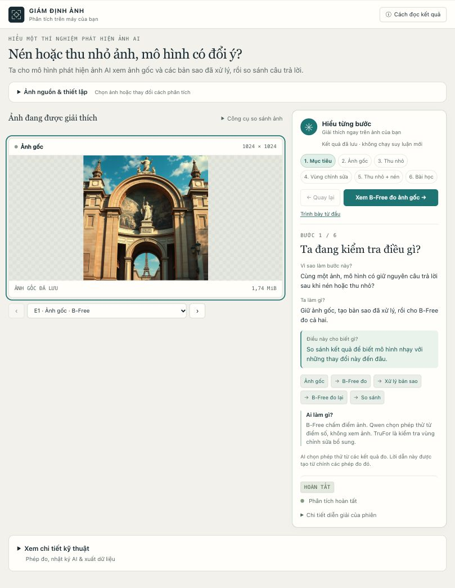
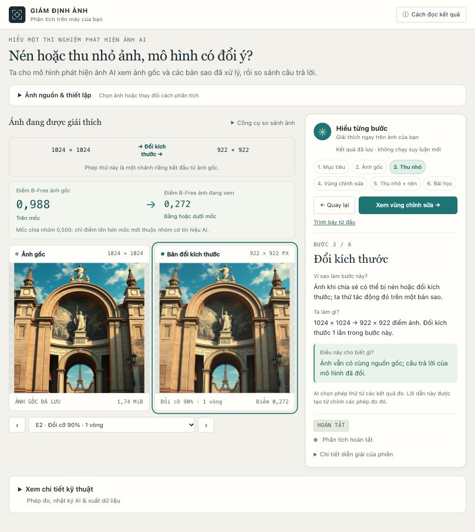
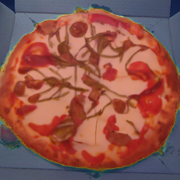
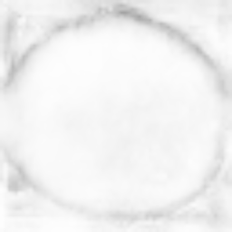

# AI Image Forensics Assistant

**Tiếng Việt (mặc định)** · [English](README.en.md)

**Nén hoặc thu nhỏ ảnh, mô hình phát hiện ảnh AI có đổi ý?**

AI Image Forensics Assistant là nguyên mẫu nghiên cứu chạy trên máy cá nhân, giúp so sánh phản hồi của mô hình trên ảnh gốc và các bản sao đã nén JPEG hoặc đổi kích thước. Giao diện tiếng Việt dẫn giải từng bước, hiển thị bằng chứng đo được và cho phép xuất dữ liệu để kiểm tra lại.

> Điểm mô hình là tín hiệu phục vụ nghiên cứu, không phải kết luận ảnh thật hay giả. Điểm ổn định qua nhiều phép thử cũng không xác minh được nguồn gốc ảnh.



*Ảnh chụp giao diện với kết quả đã lưu. Xem lại các bước không chạy suy luận mới.*

## Dự án làm được gì?

- **So sánh ảnh gốc và ảnh đã xử lý:** nén JPEG, đổi kích thước hoặc kết hợp cả hai, với chuỗi xử lý nối tiếp và đối chứng một lượt.
- **Đo tín hiệu ảnh AI bằng B-Free:** lưu logit gốc, điểm sau sigmoid và thay đổi qua các phép thử.
- **Kiểm tra từng vùng bằng TruFor:** xem bản đồ bất thường do chỉnh sửa, độ tin cậy định vị và ảnh chồng lớp.
- **Để AI chọn phép thử:** Qwen2.5-1.5B-Instruct chạy cục bộ, chọn công cụ trong phạm vi và ngân sách cho phép.
- **Xuất bằng chứng:** JSON, CSV, kích thước ảnh, dung lượng, lịch sử phép biến đổi, MSE và PSNR.

Kho mã chứa manifest, giao thức và kết quả đo của nghiên cứu thí điểm cố định gồm **320 ảnh**, cùng mô hình đối chứng FFT/DCT được huấn luyện chỉ trên ảnh gốc thuộc tập huấn luyện. Ảnh của bộ dữ liệu và trọng số mô hình không được đóng gói trong kho mã.

## Chạy ứng dụng

### Trên máy đã cài mô hình

Môi trường Python và mô hình đã được cài trên máy phát triển ban đầu. Với mỗi bản sao kho mã, chạy `python scripts/doctor.py` trước để kiểm tra các thành phần hiện có. Sau đó nhấp đúp `start.command`, hoặc chạy từ thư mục dự án:

```bash
bash scripts/start-with-models.sh
```

Mở **http://127.0.0.1:8765**. Muốn dùng cổng 8766, thêm `--port 8766` vào lệnh khởi động và mở địa chỉ tương ứng.

B-Free và TruFor trong giao diện mặc định chạy trên CPU. Bộ chọn phép thử tự dùng Apple MPS khi có hỗ trợ. Lần phân tích đầu cần nạp mô hình; quét từng vùng trên ảnh lớn có thể mất vài phút.

### Cài trên máy mới

Trên Linux hoặc macOS, chạy `bash scripts/bootstrap.sh` để tạo `.venv` và kiểm tra môi trường. Hoặc cài quy trình biến đổi và đo sai khác cơ bản bằng tay:

```bash
python3 -m venv .venv
source .venv/bin/activate
python -m pip install -r requirements.txt
python scripts/doctor.py
python -m forensics.server
```

Windows: chạy `powershell -ExecutionPolicy Bypass -File scripts\bootstrap.ps1`, rồi `run.bat`. Xem [nền tảng được hỗ trợ](docs/PLATFORMS.md) và các gói suy luận trong `requirements-models.txt`. Công cụ doctor liệt kê ảnh, thư mục mô hình, kết quả đã có và các thành phần còn thiếu. Demo đã lưu được phục vụ từ `output/model-verification/` ở chế độ chỉ đọc.

Để chạy suy luận B-Free, TruFor và bộ chọn phép thử, làm theo [hướng dẫn cài mô hình](docs/MODEL_SETUP.md). Khi chưa cấu hình mô hình, bạn vẫn xử lý và đo sai khác ảnh được; điểm phát hiện sẽ để trống. Hệ thống không tạo điểm hay bản đồ giả để thay thế.

Máy chủ chỉ lắng nghe trên máy cục bộ. Mặc định ảnh được xử lý cục bộ; nếu cấu hình endpoint Modal, ảnh sẽ được gửi tới dịch vụ đó để suy luận. Ảnh tải lên và kết quả được lưu trong `output/runs/`; xóa thư mục của một phiên để xóa ảnh nguồn và các bản sao đã lưu.

## Thử phân tích một ảnh

1. **Chọn ảnh** JPEG, PNG hoặc WebP. Giới hạn: 20 MiB, 20 megapixel, mỗi chiều ít nhất 16 pixel. Backend cũng đọc BMP/TIFF một khung hình.
2. Nhấn **Phân tích ảnh**. Mặc định, **AI chọn phép thử**: đo B-Free trên ảnh gốc trước, rồi chọn phép thử tiếp theo từ các kết quả đã có. Ngân sách mặc định là 4 lượt gọi công cụ mô hình, tính cả lượt đo ảnh gốc.
3. Đọc phần **Hiểu từng bước** để xem mục đích, thao tác và ý nghĩa của từng phép đo. Dùng **Quay lại** và nút bước tiếp theo để xem bằng chứng tương ứng.
4. Muốn tự thiết kế thí nghiệm, mở **Thiết lập nâng cao → Tự chọn thiết lập**. Chọn chất lượng JPEG 50–100, tỉ lệ 0,5–1,0, số vòng 1–5 và thứ tự xử lý khi kết hợp hai phép biến đổi.
5. Mở **Xem chi tiết kỹ thuật** để kiểm tra dữ liệu và xuất JSON/CSV. Có thể yêu cầu TruFor kiểm tra từng vùng; kết quả này được diễn giải riêng với điểm B-Free.

Trong chế độ AI chọn phép thử, mỗi phép thử là một nhánh bắt đầu từ ảnh gốc. Chế độ tự chọn hỗ trợ xử lý nối tiếp qua nhiều vòng. Lệnh dừng có hiệu lực giữa các lượt gọi công cụ. Xem [thiết kế tác tử](docs/AGENT_DESIGN.md).



*Ví dụ đã lưu: sau khi thu nhỏ, điểm B-Free đổi từ khoảng 0,988 sang 0,272 và đi qua ngưỡng 0,5. Đây là một trường hợp minh họa, không phải kết quả tổng quát về độ chính xác.*

## Đọc kết quả đúng cách

| Thành phần | Cho biết điều gì? | Cách diễn giải |
| --- | --- | --- |
| B-Free | Tín hiệu ảnh do AI tạo | Hiển thị sigmoid của logit trên thang 0–1; không phải xác suất đã được hiệu chuẩn rằng ảnh là giả. |
| TruFor | Dấu hiệu chỉnh sửa, độ tin cậy định vị và điểm giả mạo ảnh | Vùng nổi bật không chứng minh ảnh do AI tạo. Không gộp với B-Free thành một điểm tin cậy chung. |
| MSE / PSNR | Mức sai khác sau biến đổi | Đo độ méo ảnh, không đo nguồn gốc AI. |
| Điểm qua các vòng | Độ nhạy của mô hình với thao tác được thử | Điểm thay đổi hoặc ổn định đều cần được đọc trong phạm vi thí nghiệm. |

Ngưỡng B-Free mặc định dùng điều kiện nghiêm ngặt `score > 0.5`, tương đương quy tắc logit `> 0` của mô hình gốc. Điểm đúng bằng 0,5 không thuộc nhóm trên ngưỡng.

### Ví dụ kiểm tra từng vùng bằng TruFor

| Ảnh chồng lớp bất thường | Độ tin cậy định vị |
| --- | --- |
|  |  |

*Kết quả suy luận thật trên ảnh demo chính thức 256 × 256. Bản đồ độ tin cậy sáng hơn thể hiện độ tin cậy định vị cao hơn. Các ảnh này minh họa đầu ra TruFor, không xác nhận ảnh do AI tạo. Hồ sơ: [trufor-small-reference-check.json](output/model-verification/trufor-small-reference-check.json).*

### Quy ước xử lý

- **Nối tiếp (`cumulative`):** mỗi vòng nhận ảnh đã giải mã từ vòng trước. Vòng `r` có kích thước mục tiêu `round(kích_thước_gốc * scale**r)`.
- **Đối chứng một lượt (`independent`):** mỗi điều kiện bắt đầu từ ảnh gốc, đổi trực tiếp đến cùng kích thước mục tiêu và mã hóa JPEG một lần. Đối chứng chỉ nén JPEG có thể giống nhau; đó không phải các bằng chứng độc lập bổ sung.
- **Đo sai khác:** so ảnh biến đổi với ảnh gốc RGB được đổi trực tiếp về cùng kích thước bằng LANCZOS. MSE bằng 0 thì PSNR là vô hạn; JSON dùng `null` kèm quy ước rõ ràng.
- **Chuẩn hóa:** giữ nguyên byte nguồn; áp dụng hướng EXIF, chuyển RGB, ghép vùng trong suốt trên nền trắng và ghi lại thay đổi. Ảnh xem trước gốc là PNG không mất dữ liệu. Không so trực tiếp dung lượng khác định dạng như tỉ lệ nén.

## Tái lập thí nghiệm bằng dòng lệnh

### Phân tích một ảnh

```bash
python -m forensics.cli --image examples/processing-fixture.png \
  --quality 90 --scale 0.9 --rounds 3 --mode cumulative
```

Ảnh fixture là hình học nhân tạo để kiểm tra mã xử lý, không phải mẫu benchmark có nhãn thật/AI. Muốn có điểm mô hình, dùng môi trường đã cấu hình trong [MODEL_SETUP.md](docs/MODEL_SETUP.md).

### Đánh giá một tập ảnh

Tạo CSV với các cột `source_id,path,label,generator`. Đường dẫn ảnh tính từ thư mục chứa manifest; `label=1` là ảnh AI, `label=0` là ảnh thật. Tự thu thập và ghi nguồn ảnh; mỗi nhánh thí nghiệm dùng một thư mục đầu ra riêng.

```bash
python -m forensics.cli --manifest data/test.csv --operation jpeg \
  --quality 85 --rounds 3 --output output/jpeg-q85
python -m forensics.evaluation output/jpeg-q85/predictions.csv \
  --output output/jpeg-q85/evaluation.json --bootstrap-samples 5000
```

Đánh giá theo lô yêu cầu mô hình thật và từ chối dữ liệu thiếu điểm. Bộ đánh giá báo cáo AUROC, AP, balanced accuracy, TPR/FPR, Brier, NLL, ECE, dịch chuyển điểm theo cặp, thay đổi phân loại và khoảng bootstrap theo cặp.

Giữ ảnh nguồn và mọi biến thể trong cùng một tập dữ liệu. Đơn vị độc lập là ảnh nguồn; các biến thể có tương quan. Bộ đánh giá CSV lấy mẫu lại ở cấp ảnh nguồn; với nhóm ảnh thật/AI ghép cặp, dùng bộ chạy benchmark bên dưới.

### Benchmark cố định và đánh giá chính sách chọn phép thử

Nghiên cứu thí điểm dùng ảnh từ bốn họ bộ sinh Synthbuster và ảnh RAISE ghép cặp: **64 ảnh huấn luyện, 64 ảnh validation và 192 ảnh kiểm tra**. Tập validation được giữ lại và chưa dùng; mô hình FFT/DCT chỉ khớp trên ảnh gốc huấn luyện. Xem [bộ dữ liệu](docs/DATASET.md) và [giao thức benchmark](docs/BENCHMARK_PROTOCOL.md).

```bash
source scripts/model-env.sh
export BFREE_DEVICE=mps  # Thiết bị cố định của giao thức đã bàn giao.
.venv/bin/python -m forensics.benchmark run output/benchmark/protocol.json --detector bfree --splits test
.venv/bin/python -m forensics.benchmark run output/benchmark/protocol.json --detector frequency --splits train test
.venv/bin/python -m forensics.agent_evaluation run output/agent-evaluation/protocol.json
```

Các lệnh tiếp tục nhật ký có sẵn, không tự khớp lại cấu hình hay chạy lại dự đoán đã hoàn tất. Kết quả nằm trong `output/benchmark/results/{bfree,frequency}/`; biểu đồ ở `output/benchmark/figures/`.

Muốn tạo nghiên cứu mới, chạy `scripts/acquire_benchmark.py`, rồi đóng băng giao thức vào thư mục riêng trong môi trường đã cấu hình:

```bash
python -m forensics.benchmark freeze data/benchmark/manifest.csv \
  --output output/new-study --bootstrap-samples 5000 --seed 20261018
```

Giữ nguyên giao thức đã bàn giao. Bộ chạy từ chối thay đổi ảnh nguồn, danh tính mô hình, tiền xử lý hoặc mã triển khai đã đóng băng. Replay chính sách trên 24 ảnh nguồn ở `output/agent-evaluation/` đo cách chọn phép thử và chi phí lượt gọi; không đo độ trễ toàn trình hay so sánh độ chính xác xác thực ảnh.

## Suy luận tùy chọn trên Modal

Ba tác vụ Modal bổ sung năng lực suy luận từ xa, không thay thế backend ứng dụng. Bắt đầu với [hướng dẫn cài Modal](docs/MODAL_SETUP.md), gồm thứ tự cài và các biến môi trường mà ứng dụng sử dụng.

- [Chạy theo lô](docs/MODAL_BATCH.md): chấm lại 192 ảnh kiểm tra dưới chín điều kiện trên CUDA. CUDA thay đổi dấu vân tay mô hình, nên đây là nghiên cứu mới được gắn nhãn riêng, không phải phần tiếp tục của nghiên cứu MPS đã bàn giao.
- [Endpoint B-Free](docs/MODAL_ENDPOINT.md): chấm ảnh qua endpoint có xác thực, giúp người dùng không cần cài PyTorch và trọng số cục bộ.
- [Endpoint TruFor](docs/MODAL_TRUFOR.md): quét từng vùng qua endpoint; trọng số được tải và kiểm tra khi dựng image riêng tư.

Khi không cấu hình endpoint, ảnh không rời máy. Khi cấu hình endpoint tương ứng, ảnh tải lên và các biến thể được gửi tới Modal để chấm điểm.

## Tài liệu và kiểm tra

| Nội dung | Tài liệu |
| --- | --- |
| Báo cáo nghiên cứu | [Research write-up](docs/RESEARCH_WRITEUP.md) · [Báo cáo PDF](output/pdf/AI_Image_Forensics_Research_Report.pdf) |
| Kết quả đã đo | [Benchmark](docs/BENCHMARK_RESULTS.md) · [Chính sách tác tử](docs/AGENT_RESULTS.md) |
| Thiết kế và giao thức | [Tác tử](docs/AGENT_DESIGN.md) · [Thí nghiệm](docs/EXPERIMENT_PROTOCOL.md) · [Benchmark](docs/BENCHMARK_PROTOCOL.md) |
| Cài mô hình và dữ liệu | [Model setup](docs/MODEL_SETUP.md) · [Dataset](docs/DATASET.md) |
| Giao diện | [Nghiên cứu UI](docs/UI_RESEARCH.md) · [Kiểm tra UI tác tử](docs/AGENT_UI_QA.md) · [Kiểm tra hướng dẫn từng bước](docs/GUIDED_UI_QA.md) |
| Nghiên cứu tiếp theo | [Lưới resize × JPEG tìm điểm gãy](docs/BREAKPOINT_PROTOCOL.md) — đã đặc tả, chưa chấm điểm |

Các tài liệu chuyên sâu hiện chủ yếu bằng tiếng Anh. Bằng chứng kỹ thuật bổ sung nằm trong `output/verification/processing-check.json` và `output/model-verification/`, gồm chuỗi điểm B-Free thực, đối chiếu logit với mẫu chính thức và bản đồ TruFor.

Chạy kiểm tra phần mềm:

```bash
python -m unittest discover -s tests -v
node --test tests/test_guide.cjs
```

Dựng lại báo cáo sau khi có đủ kết quả và biểu đồ:

```bash
python -m pip install -r requirements-report.txt
python scripts/build_report.py
```

Bộ dựng kiểm tra độ đầy đủ và danh tính giao thức trước khi xuất PDF cùng Markdown có thể chỉnh sửa; kết quả chưa đủ không được gắn nhãn nghiên cứu đã hoàn tất.

## Giới hạn nghiên cứu

Đây là nguyên mẫu nghiên cứu chạy localhost, chưa có tài khoản hay triển khai công khai. Qwen chọn bước tiếp theo từ quan sát; bộ điều phối và bộ dựng báo cáo áp đặt giới hạn xác định, các nhận định dẫn đến bằng chứng đo được.

Ảnh nhỏ, bộ sinh chưa biết, chỉnh sửa và nén trước đó đều có thể ảnh hưởng kết quả. Khác biệt độ phân giải và tiền xử lý giữa các nguồn là yếu tố gây nhiễu của nghiên cứu thí điểm. Khoảng tin cậy mô tả bất định lấy mẫu trong tập thí điểm, không phải xác suất một ảnh cụ thể là thật. Kết quả chưa chứng minh khả năng tổng quát sang họ bộ sinh mới, cũng không loại trừ khả năng B-Free đã tiếp xúc Synthbuster trong quá trình phát triển mô hình gốc. Chuỗi chất lượng JPEG thay đổi và hiệu chuẩn học được vẫn là hướng phát triển.

## Nguồn và điều khoản sử dụng

Mã, trọng số và dữ liệu của bên thứ ba giữ nguyên điều khoản của tác giả, gồm các giới hạn thông tin, nghiên cứu hoặc phi lợi nhuận tương ứng. Kiểm tra giấy phép upstream trước khi tái sử dụng.

- Guillaro và cộng sự, **B-Free**: [bài báo](https://arxiv.org/abs/2412.17671) · [mã chính thức](https://github.com/grip-unina/B-Free).
- Guillaro và cộng sự, **TruFor**, CVPR 2023: [mã chính thức](https://github.com/grip-unina/TruFor).
- Qwen Team, [Qwen2.5-1.5B-Instruct](https://huggingface.co/Qwen/Qwen2.5-1.5B-Instruct), Apache-2.0. Cài bằng `.venv/bin/python scripts/install-planner.py` trong môi trường mô hình.
- [Synthbuster](https://zenodo.org/records/10066460), CC BY-NC-SA 4.0; [RAISE](https://loki.disi.unitn.it/RAISE/), giữ các điều khoản nghiên cứu và phi thương mại đi kèm bộ dữ liệu.
