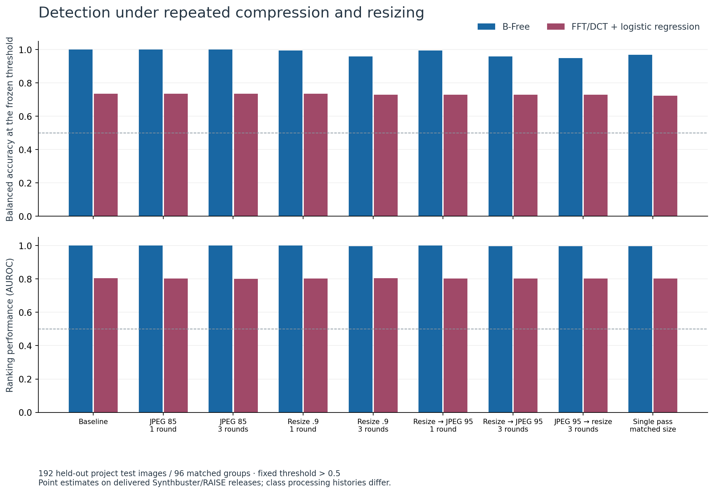
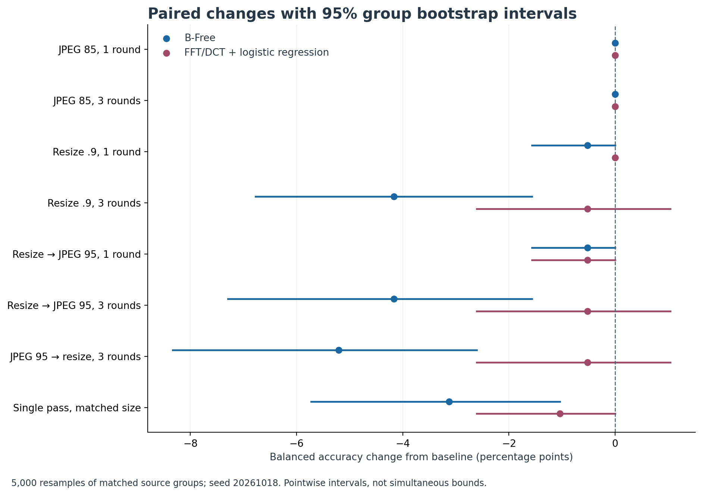
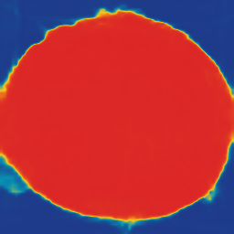
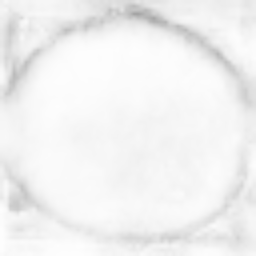
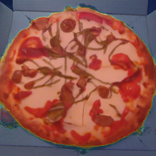

## Research report

# Evaluating AI-Generated Image Detection Under Repeated Compression and Resizing

A local image-forensics assistant, a frozen detector benchmark, and a bounded language-model investigation policy

Completed pilot | 18 October 2026 | Reproducible measurements and research limitations

### Abstract

This project studies how repeated image processing changes AI-generation detector evidence. A local prototype integrates B-Free for whole-image generation scores and TruFor for distinct local-manipulation maps. A controlled pilot contains 320 released images: 160 real photographs and 160 generated images across four generators, grouped by matched source/prompt. A 64/64/192 training/validation/test split prevents matched pairs from crossing splits. Nine prespecified image conditions yield 1,728 held-out predictions per detector. B-Free is compared with a train-only FFT/DCT logistic-regression baseline.

B-Free balanced accuracy changed from 100.0% on originals to 100.0% after three JPEG quality-85 encodes. The paired change was +0.0 percentage points (95% group-bootstrap interval +0.0 to +0.0). This interval is degenerate because no observed group changed the endpoint; it does not establish zero uncertainty on new data.

A small local Qwen model selects allowed investigation tools from observed measurements, under a four-call default budget. Its factual report is calculated from evidence records rather than generated freely. A separate 24-source score-replay experiment compares fixed, rule-based and language-model policies. The contribution is a reproducible measurement and investigation system; the study does not establish universal detection accuracy, calibrated authenticity probabilities or superiority of an AI agent.

### Research questions

RQ1: How do repeated JPEG compression, repeated resizing, processing order and matched-size single-pass controls change detector discrimination and fixed-threshold decisions? RQ2: Can a bounded observation-driven policy identify processing-sensitive evidence while making fewer tool calls than a fixed workflow? RQ3: How can the interface communicate measured evidence and uncertainty without conflating generation detection with manipulation localization?

## Dataset and experimental design

### A documented, grouped pilot

The data come from the official Synthbuster release and the real RAISE-1k subset distributed for B-Free's extended Synthbuster evaluation. Four generators were selected before scoring: DALL-E 3, Adobe Firefly, Midjourney v5 and Stable Diffusion XL. Each contributes 40 generated images matched to 40 distinct real photographs by the common RAISE filename stem. A real photograph is used once. SHA-256-ranked selection with fixed seed 20261018 creates 160 groups. Each generator stratum contributes 8 training, 8 validation and 24 test groups: 64, 64 and 192 images overall. [5, 6]

The acquisition script retrieves only selected ZIP members using HTTP byte ranges, verifies original ZIP CRC values, and records source URLs and file hashes. Selection is frozen before downloads and missing files are not silently replaced. Original release bytes are retained. The full manifest, source metadata, license files and selection plan are available with the project. Synthbuster uses CC BY-NC-SA 4.0; RAISE carries scientific/research and noncommercial terms.

The real release has already been resized to approximately one megapixel, while synthetic files retain different delivered dimensions. These are released originals, not uniformly pristine camera/generator outputs. Content, generator, dimension and prior-processing differences may affect absolute classification performance. Within-source processing changes are therefore the central result. Synthbuster was used in upstream B-Free research: project-held-out test images are not claimed to be unseen during all upstream model development.

### Prespecified conditions

| Arm | Operations and final observation |
| --- | --- |
| Original | RGB-normalized lossless baseline; no experimental distortion. |
| JPEG x1 / x3 | Quality 85, 4:2:0; score after one or three cumulative encodes. |
| Resize x1 / x3 | LANCZOS; 90% per round, score after round 1 or 3. |
| Resize + JPEG x1 / x3 | 90% resize then quality-95 JPEG at each round. |
| Reversed order x3 | Quality-95 JPEG then 90% resize, repeated three times. |
| Matched single pass | Start from original; resize directly to round-3 dimensions and JPEG once. |

At round r, target dimensions equal round(original dimension x 0.9^r). Cumulative arms use the previous decoded image. Independent controls use the original at the matched final dimensions. A JPEG-then-resize result is stored as PNG to avoid an extra unplanned JPEG encode. Every derivative remains associated with its original source and matched group.

## Models, measurements and statistical analysis

### Detector and classical baseline

B-Free uses the official pretrained DINOv2-based implementation and its native normalization and embedding-view aggregation. The adapter retains the raw logit and its sigmoid. The fixed positive rule is score > 0.5, equivalent to logit > 0; equality is negative. The official checkpoint and source revision are hashed. Four integration samples were checked against upstream reference logits. The MPS run differed from the CPU check by at most 0.000035 logit units, with identical decisions. No B-Free fitting or threshold tuning uses this pilot. [1, 2]

The comparator uses 79 features: 16 radial FFT log-power averages and 63 mean absolute block-DCT AC coefficients. Normalized RGB images are converted to luminance and resized to 256 x 256. Mean and standard deviation are fitted on training originals only. A fixed L2 logistic regression (penalty coefficient 0.01) is fitted by deterministic Newton optimization. Its features, optimizer and threshold are frozen; validation images are reserved and unused. This small baseline is an interpretable comparison, not a strong state-of-the-art detector or fallback for missing inference.

TruFor uses its official inference code to produce a local-manipulation score, anomaly map and reliability map. These address a different task from generation detection. Its maps are demonstrated in the prototype but no pixel-level localization accuracy is evaluated because the pilot provides image-level origin labels. [3, 4]

### Endpoints and uncertainty

The primary endpoint is the paired balanced-accuracy difference between three JPEG quality-85 encodes and the original at the fixed threshold. A 95% percentile interval uses 5,000 bootstrap samples of complete matched groups, retaining both real and generated sources and their paired conditions. The test set contains 96 matched groups treated as sampling units; between-group independence is an assumption. Other conditions, AUROC, average precision, TPR/FPR, confusion counts, score shifts and flips are descriptive secondary outcomes. No multiple-comparison significance claims are made.

Brier score, NLL and ten-bin positive-class ECE are exported as descriptive calibration diagnostics; sigmoid outputs are not asserted to be calibrated probabilities. AUROC assigns half credit to ties and AP groups equal scores. Failures remain missing and are journaled. Derivatives never become independent samples. Distortion is measured with RGB MSE and PSNR against the original resized directly to each derivative's dimensions; zero MSE implies infinite PSNR, represented as null with an explicit convention.

### Execution and audit

A frozen protocol hashes the manifest, normalized pixels, model checkpoint, preprocessing implementation, conditions and software versions before inference. An append-only prediction/failure journal and content-addressed score cache support exact resume without silently changing the study. B-Free test inference uses Apple MPS in float32. The frequency baseline uses NumPy. Model training provenance and all measured predictions are retained.

## Held-out detector results

### Complete nine-condition comparison

Each table cell is measured on the same 192 held-out images (96 real, 96 generated; 24 generated images per family). Each detector completed 1,728 test predictions. Recorded failure attempts: B-Free 0; FFT/DCT 0. Balanced accuracy (bAcc) uses the fixed 0.5 threshold; AUC is AUROC.

| Condition | B-Free bAcc | B-Free AUC | FFT/DCT bAcc | FFT/DCT AUC |
| --- | --- | --- | --- | --- |
| Original | 100.0% | 1.000 | 73.4% | 0.804 |
| JPEG Q85 x1 | 100.0% | 1.000 | 73.4% | 0.802 |
| JPEG Q85 x3 | 100.0% | 1.000 | 73.4% | 0.801 |
| Resize 90% x1 | 99.5% | 1.000 | 73.4% | 0.803 |
| Resize 90% x3 | 95.8% | 0.996 | 72.9% | 0.804 |
| Resize + Q95 x1 | 99.5% | 1.000 | 72.9% | 0.802 |
| Resize + Q95 x3 | 95.8% | 0.997 | 72.9% | 0.803 |
| Q95 + resize x3 | 94.8% | 0.997 | 72.9% | 0.803 |
| Matched single pass | 96.9% | 0.997 | 72.4% | 0.802 |

B-Free balanced accuracy changed from 100.0% on originals to 100.0% after three JPEG quality-85 encodes. The paired change was +0.0 percentage points (95% group-bootstrap interval +0.0 to +0.0). This interval is degenerate because no observed group changed the endpoint; it does not establish zero uncertainty on new data.

The frequency comparator had 0 threshold changes among 192 paired originals and Q85 round-3 images, with mean absolute score change 0.004142. Its paired bootstrap interval collapses to [0, 0] because the observed groups contain no balanced-accuracy changes. This degenerate interval cannot establish zero population uncertainty or rule out changes on new images.

### Interpretation

One Q85 encode gave B-Free balanced accuracy of 100.0%; three gave 100.0%. The primary baseline-to-round-3 contrast includes the first encode and cannot attribute its entire change to repetition alone. For B-Free, resizing alone changed balanced accuracy to 99.5% after one round and 95.8% after three. Three resize-then-Q95 rounds reached 95.8%, compared with 96.9% for one resize/JPEG pass at the same final dimensions. Reversing the repeated operation order reached 94.8%. Resizing rounds differ in final dimensions; the matched-size arm helps isolate processing history. These secondary comparisons are descriptive.

AUROC measures ranking; balanced accuracy measures the frozen operating point. A threshold-performance change can reflect a score shift with little loss of ranking. Use the paired statistics for magnitude, and treat secondary intervals as descriptive.

These values apply to this small, balanced released-data pilot, with possible upstream exposure and class-processing confounds. They do not establish performance on arbitrary internet uploads or unknown generators. Stable averages and high individual scores do not verify an image's origin.

## Robustness across conditions

Figure 1. Measured balanced accuracy and AUROC on the common 192-image test set. These are nine conditions on the same sources, not independent experiments. The FFT/DCT comparator was fitted only on training originals.

Figure 2. Paired changes from original balanced accuracy, with 95% group-bootstrap intervals. Only JPEG quality-85 round 3 is the prespecified primary endpoint; other intervals are descriptive.

## An observation-driven forensics assistant

### Finite tools, actual language-model choices

The application performs one mandatory original B-Free measurement, then supplies its observations and the remaining budget to a local Qwen2.5-1.5B-Instruct model. The model chooses among one JPEG Q85 pass, three JPEG Q85 passes, one 90% resize, three resize/Q95 rounds, optional TruFor, and finish. Every perturbation branch starts from the original; repeated operations occur within that branch. Only the branch's final image is scored. [7]

| Stage | Responsibility |
| --- | --- |
| Observe | Read image dimensions and actual model measurements. |
| Choose | Qwen scores the tokens for offered numbered actions. |
| Validate | Dispatcher enforces the allowlist, no repeats, and call budget. |
| Execute | Run the chosen detector tool and record evidence with an ID. |
| Reassess | Feed the new observations back; stop or select another tool. |
| Explain | Compute a factual report from cited measurement records. |

This is constrained next-token action selection: the highest-logit allowed digit selects a tool. It is not a hardcoded score-routing loop, nor free-form command generation. The default cap is four detector-tool attempts including the original, adjustable from two to six. Failures consume budget. Cancellation takes effect between calls. A fixed policy and a rule policy remain explicitly separate comparators. There is no rule fallback when the language model fails.

The planner sees numeric observations, not image pixels, filenames, embedded metadata text or ground-truth labels. No arbitrary code, shell or network tool is available. Model action weights describe relative preference over the offered actions, not forensic confidence. The audit trace retains observed evidence, offered actions, chosen action, prompt/policy hashes, model hashes, runtime and device. Action ordering is fixed and possible positional bias is unmeasured.

### Grounded uncertainty in the UI

The report builder calculates score ranges, decision changes and successful-test counts directly from evidence E1, E2 and so on. It does not ask the model to invent a final rationale. If no perturbation succeeds, the result says robustness evidence is insufficient. The interface separates fixed trajectories from adaptive branches, shows actual manipulation/reliability maps when available, and exports JSON/CSV. B-Free and TruFor are never merged into one authenticity score.

## Policy comparison and observed behavior

### A separate 24-source replay pilot

Three matched real/generated test groups per generator were selected by a fixed SHA-256 ranking before policy scoring. The 24-source subset compares a fixed four-call sequence, an explicit rule baseline and local Qwen under the same four-call budget. Each policy receives only observations for tools it selects. Recorded B-Free scores are replayed to avoid redundant inference; newly measured planner runtime is separate from recorded detector time. TruFor is disabled for matched replay because the benchmark does not include regional observations.

The reference event is a threshold change in any of the four available perturbation branches. Discovery recall is the fraction of reference-unstable images on which the policy observes at least one change. It is not image-authenticity accuracy. A four-call budget includes the original and therefore cannot exhaust all four perturbations.

| Policy | Episodes | Mean calls | Changes found | Discovery recall |
| --- | --- | --- | --- | --- |
| Fixed workflow | 24 | 4.00 | 1/1 | 100.0% |
| Rule baseline | 24 | 2.54 | 1/1 | 100.0% |
| Local Qwen | 24 | 4.00 | 1/1 | 100.0% |

Fixed workflow: 0 failed episodes; 24/24 valid-action episodes; 24/24 budget-compliant episodes; 24/24 with valid evidence references. Rule baseline: 0 failed episodes; 24/24 valid-action episodes; 24/24 budget-compliant episodes; 24/24 with valid evidence references. Local Qwen: 0 failed episodes; 24/24 valid-action episodes; 24/24 budget-compliant episodes; 24/24 with valid evidence references.

### Interpretation and limits

Only 1 of the 24 selected sources had reference-catalog instability, so the discovery-recall denominator is very small. Local Qwen found 1/1 reference events using 4.00 mean calls; the fixed workflow found 1/1 using 4.00, and the rule policy found 1/1 using 2.54. The measured pilot provides no observed discovery or tool-call advantage for the language-model policy. A larger, more challenging preregistered policy study is needed before making a benefit claim.

The comparison describes tool-use cost and discovery within a finite catalog. The small sample supports no inferential superiority claim, and failure to find a change is not evidence of general robustness. Budget compliance, valid actions and evidence-reference validity are checked structurally; they do not establish human-rated explanation quality. Qwen used the same three-test sequence for all 24 images.

### Real end-to-end example

| Evidence | Measured test | B-Free score | Change from original |
| --- | --- | --- | --- |
| E1 | Original | 0.9882 | - |
| E2 | JPEG Q85 x3 | 0.7934 | -0.1948 |
| E3 | Resize 90% x1 | 0.2719 | -0.7163 |

The official B-Free img0002 example was used for integration, separately from the benchmark. Qwen chose three JPEG passes, then a resize, then finish, using 3 of four model calls in 27.6 seconds including initial planner loading. The report correctly identified one threshold change. This is an illustrative execution, not representative runtime or a policy-quality estimate.

## Regional evidence and validity limits

### Manipulation maps answer a different question

TruFor was run on the official 256 x 256 tampered2 example. It returned an actual manipulation score of 0.998346 and the maps below. No pixel-accuracy metric was calculated. The same integration also ran TruFor on the B-Free img0002 original, obtaining 0.032239 despite B-Free's 0.988232 AI-generation score. Fully generated content can lack a localized inconsistency; the outputs address different tasks. [2, 4]

*Source: artifact not in this repository.*

Figure 3. Official TruFor example: source, manipulation-anomaly map, localization reliability, and overlay. Anomaly uses a fixed blue-to-red 0-1 scale; reliability uses black-to-white. Neither map is AI-pixel attribution.

### Threats to validity

The pilot has four known generator families, no newly held-out generator family, a small training set and source-dependent preprocessing. Related groups can still share scene properties across splits; grouped selection does not guarantee semantic independence. Upstream research exposure is possible. The bootstrapped interval reflects group sampling variation within this design, not every source of model or dataset uncertainty.

Repeated encoding at fixed quality may stabilize, while screenshots, mixed generated/real content, different encoders, prior compression and severe resizing may behave differently. Very small images can alter detector padding/cropping behavior. The local planner is small and does not visually inspect content. It can stop early, choose redundant scientific tests or overlook a useful branch despite valid dispatch. The deterministic report protects measurement grounding but cannot fix a poor investigation strategy.

### Next research steps

Expand the dataset with independent sources and new generator families; repeat the study with controlled release formats and dimensions; evaluate policy repetitions and action-order randomization; compare latency in full end-to-end runs; and separately evaluate regional localization with masks and human review. Threshold calibration, if introduced, must use validation data and be frozen before new test evaluation.

## Reproduction and references

### Run the prototype and inspect the evidence

Start with bash scripts/start-with-models.sh and open http://127.0.0.1:8765. The fixed mode runs explicit transformations; Adaptive investigation uses the local Qwen model. Images and outputs remain on this machine. Each saved run contains source bytes, hashes, measured evidence and exports. The browser has no public deployment or account layer.

Reproduce acquisition with scripts/acquire_benchmark.py; freeze a new study with python -m forensics.benchmark freeze; execute with its run subcommand and a configured detector. The delivered output/benchmark/protocol.json is immutable and identifies the completed pilot. Exact commands are documented in README.md and docs/BENCHMARK_PROTOCOL.md. Re-run tests with .venv/bin/python -m unittest discover -s tests -v.

Detector study hash: 1c974e78ed2d391de1cd1897ac2513c757b2016917d621e3f38c97362ef5aafa. Agent evaluation hash: b34b11babb166808d5ddfdb45b14917ce6b11792c208fb73a8d91e1aa519d6c3. Detailed results: output/benchmark/results/*/predictions.csv and summary.json; output/agent-evaluation/episodes.jsonl and summary.json. Editable narrative: docs/RESEARCH_WRITEUP.md. Figures are exported as PNG and PDF.

### References

[1] Guillaro et al. A Bias-Free Training Paradigm for More General AI-generated Image Detection. arXiv:2412.17671. https://arxiv.org/abs/2412.17671

[2] GRIP-UNINA. B-Free official code and released evaluation data. Revision c6a9f898782fb466b29af01f21960b67415afb0e. https://github.com/grip-unina/B-Free

[3] Guillaro et al. TruFor: Leveraging All-Round Clues for Trustworthy Image Forgery Detection and Localization. CVPR 2023. https://openaccess.thecvf.com/content/CVPR2023/html/Guillaro_TruFor_Leveraging_All-Round_Clues_for_Trustworthy_Image_Forgery_Detection_and_CVPR_2023_paper.html

[4] GRIP-UNINA. TruFor official implementation. Revision ae54475df6f41a491d7615100feb19263dec13f7. https://github.com/grip-unina/TruFor

[5] Synthbuster official dataset release, Zenodo record 10066460. https://zenodo.org/records/10066460

[6] RAISE dataset, University of Trento; subset distributed with B-Free extended Synthbuster. https://loki.disi.unitn.it/RAISE/

[7] Qwen Team. Qwen2.5-1.5B-Instruct model card. Revision 989aa7980e4cf806f80c7fef2b1adb7bc71aa306. https://huggingface.co/Qwen/Qwen2.5-1.5B-Instruct

[8] ForgeryVCR. Related tool-driven forensics architecture; its implementation is not a dependency of this prototype. https://github.com/youqiwong/ForgeryVCR

[9] Mobbin UI research: Higgsfield editing and Magnific preview patterns. https://mobbin.com/screens/73d5ba0d-57b7-4468-901c-ad060319ff66 and https://mobbin.com/screens/7e4ff51f-2eee-4468-8962-1072825d901e
