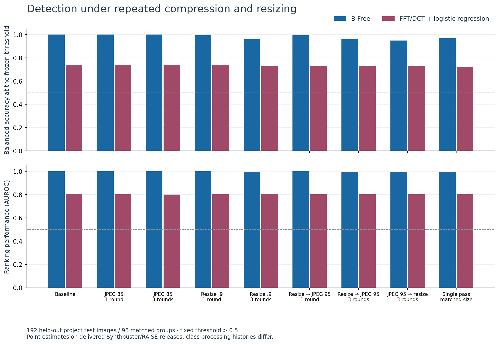
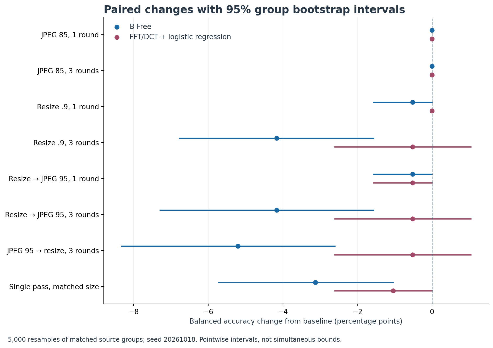
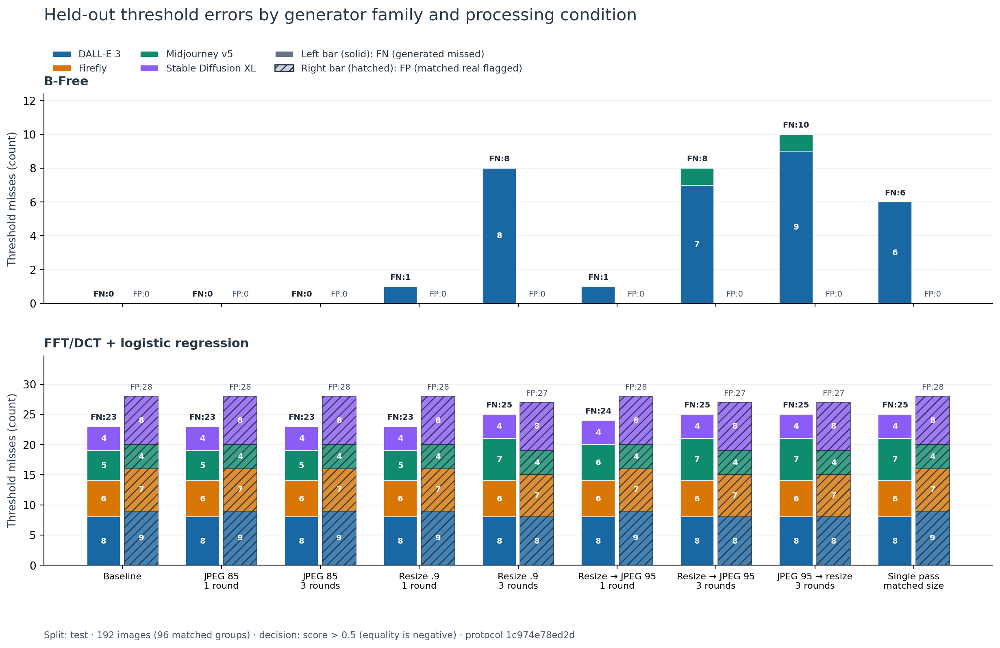
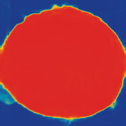
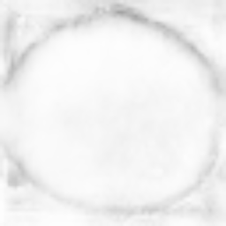
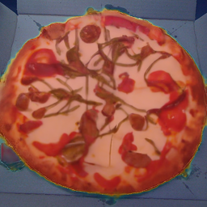

## Báo cáo nghiên cứu

# Đánh giá khả năng phát hiện ảnh do AI tạo dưới tác động của nén và đổi kích thước lặp lại

Trợ lý giám định ảnh cục bộ, benchmark cố định các bộ phát hiện, và chính sách điều tra có giới hạn bằng mô hình ngôn ngữ

Nghiên cứu thí điểm đã hoàn tất | 18 tháng 10 năm 2026 | Các phép đo tái lập được và giới hạn nghiên cứu

### Tóm tắt

Dự án này nghiên cứu cách các thao tác xử lý ảnh lặp lại làm thay đổi bằng chứng của bộ phát hiện ảnh do AI tạo. Nguyên mẫu chạy cục bộ tích hợp B-Free để chấm điểm ảnh AI trên toàn ảnh và TruFor để tạo bản đồ dấu hiệu chỉnh sửa cục bộ tách biệt. Nghiên cứu thí điểm có đối chứng gồm 320 ảnh đã công bố: 160 ảnh chụp thật và 160 ảnh sinh bởi bốn họ bộ sinh, được ghép cặp theo ảnh nguồn/prompt tương ứng. Tập dữ liệu được chia theo tỷ lệ 64/64/192 cho huấn luyện/validation/kiểm tra nhằm ngăn các cặp ghép vượt qua ranh giới tập chia. Chín điều kiện ảnh xác định trước tạo ra 1.728 dự đoán trên tập kiểm tra giữ lại cho mỗi bộ phát hiện. B-Free được so sánh với mô hình đối chứng hồi quy logistic FFT/DCT chỉ khớp trên ảnh gốc thuộc tập huấn luyện.

Balanced accuracy của B-Free giữ ở mức 100,0% trên ảnh gốc và 100,0% sau ba lần nén JPEG chất lượng 85. Thay đổi ghép cặp là +0,0 điểm phần trăm (khoảng bootstrap theo nhóm 95% từ +0,0 đến +0,0). Khoảng này bị suy biến vì không có nhóm quan sát nào làm đổi kết cục đầu cuối; kết quả này không chứng minh bất định bằng 0 trên dữ liệu mới. Phân tích hậu kiểm cho thấy các trường hợp tụt qua ngưỡng liên quan đến đổi kích thước tập trung ở DALL-E 3 (34 sự kiện âm tính giả trên 11 nguồn ảnh AI duy nhất; trong đó DALL-E 3 chiếm 32 sự kiện trên 9 nguồn và Midjourney v5 chiếm 2 sự kiện trên 2 nguồn). AUROC tổng hợp vẫn đạt ít nhất 0,9962 trong khi balanced accuracy giảm xuống 94,79%. Các chỉ số chẩn đoán hiệu chuẩn cũng thay đổi dưới tác động xử lý. Đây là các phát hiện mang tính thăm dò trên cùng tập nguồn kiểm tra giữ lại, không phải các thí nghiệm độc lập.

Một mô hình Qwen nhỏ chạy cục bộ chọn các công cụ điều tra được phép dựa trên các phép đo đã quan sát, trong giới hạn ngân sách mặc định 4 lượt gọi. Báo cáo sự kiện thực tế được tính toán xác định từ các bản ghi bằng chứng thay vì sinh tự do. Một thí nghiệm phát lại điểm số riêng biệt trên 24 nguồn so sánh các chính sách cố định, dựa trên quy tắc và mô hình ngôn ngữ.

**Ba đóng góp chính của nghiên cứu:**
1. **Đo lường thực nghiệm có kiểm soát qua 9 điều kiện xử lý:** Đánh giá có đối chứng tác động của nén JPEG lặp lại, thu nhỏ kích thước lặp lại, đảo thứ tự xử lý và đối chứng một lượt khớp kích thước trên 320 ảnh ghép cặp (1.728 dự đoán kiểm tra mỗi bộ phát hiện), đối chiếu B-Free với mô hình đối chứng FFT/DCT.
2. **Phân tích lỗi theo họ bộ sinh, xếp hạng và chẩn đoán hiệu chuẩn hậu kiểm:** Tách riêng lỗi vượt ngưỡng theo từng họ bộ sinh trên 96 nhóm ghép cặp, chỉ ra sự phân tách giữa năng lực xếp hạng (AUROC ≥ 0,9962) và điểm vận hành ngưỡng cố định (`score > 0.5`, balanced accuracy giảm còn 94,79%), đồng thời định lượng thay đổi Brier, NLL và ECE qua từng điều kiện.
3. **Hệ thống giám định ảnh cục bộ minh bạch bằng chứng và chính sách điều tra có giới hạn:** Xây dựng ứng dụng web cục bộ tách biệt tín hiệu ảnh AI (B-Free) với định vị chỉnh sửa cục bộ (TruFor), sinh lời dẫn từ chính bằng chứng đo được (`E1`, `E2`…), và đánh giá phát lại chính sách trên 24 nguồn cho thấy chưa có lợi thế thực nghiệm của chính sách LLM so với quy trình cố định hay quy tắc đơn giản.

Nghiên cứu này không khẳng định độ chính xác phát hiện phổ quát, xác suất xác thực đã hiệu chuẩn, quy kết nhân quả theo bộ sinh hay tính ưu việt của tác tử AI.

### Câu hỏi nghiên cứu

RQ1: Nén JPEG lặp lại, đổi kích thước lặp lại, thứ tự xử lý và các đối chứng một lượt khớp kích thước làm thay đổi khả năng phân biệt và các quyết định theo ngưỡng cố định của bộ phát hiện như thế nào? RQ2: Một chính sách điều hướng theo quan sát có giới hạn có thể nhận diện bằng chứng nhạy cảm với xử lý với ít lượt gọi công cụ hơn quy trình cố định hay không? RQ3: Giao diện có thể truyền đạt bằng chứng đo được và sự bất định như thế nào mà không đánh đồng phát hiện ảnh AI với định vị chỉnh sửa cục bộ?

## Tập dữ liệu và thiết kế thí nghiệm

### Nghiên cứu thí điểm có tài liệu hóa và phân nhóm

Dữ liệu được lấy từ bản phát hành chính thức của Synthbuster và tập con ảnh thật RAISE-1k phân phối kèm đánh giá Synthbuster mở rộng của B-Free. Bốn họ bộ sinh được chọn trước khi chấm điểm: DALL-E 3, Adobe Firefly, Midjourney v5 và Stable Diffusion XL. Mỗi họ đóng góp 40 ảnh AI được ghép cặp với 40 ảnh chụp thật riêng biệt thông qua phần tên gốc chung của RAISE. Mỗi ảnh chụp thật chỉ được dùng một lần. Việc chọn mẫu xếp hạng theo SHA-256 với seed cố định `20261018` tạo ra 160 nhóm. Mỗi tầng bộ sinh đóng góp 8 nhóm huấn luyện, 8 nhóm validation và 24 nhóm kiểm tra: tổng cộng 64, 64 và 192 ảnh. [5, 6]

Script thu thập chỉ tải các thành viên ZIP được chọn bằng HTTP byte range, kiểm tra lại giá trị CRC gốc của ZIP, và lưu URL nguồn cùng mã băm tệp. Danh sách chọn được đóng băng trước khi tải và các tệp thiếu không bị thay thế âm thầm. Các byte gốc từ bản phát hành được giữ nguyên. Bản kê khai (manifest) đầy đủ, siêu dữ liệu nguồn, tệp giấy phép và kế hoạch chọn mẫu đều đi kèm dự án. Synthbuster sử dụng giấy phép CC BY-NC-SA 4.0; RAISE mang điều khoản khoa học/nghiên cứu và phi thương mại.

Bản phát hành ảnh thật đã được đổi kích thước sẵn về khoảng 1 megapixel, trong khi các tệp ảnh sinh giữ nguyên kích thước phân phối khác nhau. Đây là các ảnh gốc đã phát hành, không phải ảnh nguyên bản đồng nhất từ máy ảnh hay bộ sinh. Khác biệt về nội dung, bộ sinh, kích thước và tiền xử lý có thể ảnh hưởng đến hiệu năng phân loại tuyệt đối. Do đó, mức thay đổi khi xử lý trong cùng một ảnh nguồn là kết quả trung tâm. Synthbuster từng được dùng trong nghiên cứu gốc của B-Free: các ảnh kiểm tra giữ lại của dự án không được khẳng định là hoàn toàn chưa từng xuất hiện trong quá trình phát triển mô hình thượng nguồn.

### Chín điều kiện xử lý xác định trước

| Nhánh điều kiện | Thao tác và quan sát cuối cùng |
| --- | --- |
| Original (Ảnh gốc) | Ảnh tham chiếu không mất dữ liệu chuẩn hóa RGB; không có biến dạng thực nghiệm. |
| JPEG x1 / x3 | Chất lượng 85, lấy mẫu màu 4:2:0; chấm điểm sau một hoặc ba lần mã hóa tích lũy. |
| Resize x1 / x3 | LANCZOS; tỷ lệ 90% mỗi vòng, chấm điểm sau vòng 1 hoặc vòng 3. |
| Resize + JPEG x1 / x3 | Thu nhỏ 90% rồi nén JPEG chất lượng 95 ở mỗi vòng. |
| Reversed order x3 | Nén JPEG chất lượng 95 rồi thu nhỏ 90%, lặp lại ba lần. |
| Matched single pass | Bắt đầu từ ảnh gốc; đổi kích thước trực tiếp về kích thước vòng 3 và nén JPEG một lần. |

Tại vòng `r`, kích thước đích bằng `round(kích_thước_gốc × 0.9^r)`. Các nhánh tích lũy sử dụng ảnh đã giải mã từ vòng trước. Các đối chứng độc lập sử dụng ảnh gốc ở cùng kích thước cuối. Kết quả JPEG-rồi-đổi-kích-thước được lưu dưới dạng PNG để tránh phát sinh thêm một lần mã hóa JPEG ngoài kế hoạch. Mọi biến thể đều giữ liên kết với ảnh gốc và nhóm ghép cặp tương ứng.

## Mô hình, phép đo và phân tích thống kê

### Bộ phát hiện và mô hình đối chứng cổ điển

B-Free sử dụng mã nguồn chính thức dựa trên DINOv2 cùng chuẩn hóa và tổng hợp embedding-view nguyên bản. Bộ chuyển đổi (adapter) lưu giữ cả logit thô và giá trị sigmoid của nó. Quy tắc dương tính cố định là `score > 0.5`, tương đương `logit > 0`; giá trị bằng đúng ngưỡng tính là âm tính. Checkpoint và mã phiên bản nguồn chính thức đều được băm kiểm chứng. Bốn mẫu tích hợp đã được đối chiếu với logit tham chiếu từ mã gốc. Chạy trên MPS sai khác tối đa `0.000035` đơn vị logit so với kiểm tra trên CPU, với cùng quyết định phân loại. Không có bước khớp tham số hay tinh chỉnh ngưỡng nào của B-Free sử dụng dữ liệu thí điểm này. [1, 2]

Mô hình đối chứng sử dụng 79 đặc trưng: 16 trung bình công suất log phổ FFT theo bán kính và 63 hệ số AC trung bình tuyệt đối theo khối DCT. Ảnh RGB chuẩn hóa được chuyển sang độ chói (luminance) và đổi kích thước về `256 × 256`. Trung bình và độ lệch chuẩn chỉ được khớp trên ảnh gốc của tập huấn luyện. Một mô hình hồi quy logistic L2 cố định (hệ số phạt `0.01`) được khớp bằng tối ưu Newton xác định. Các đặc trưng, bộ tối ưu và ngưỡng đều được đóng băng; ảnh validation được giữ riêng và không sử dụng. Mô hình đối chứng nhỏ này đóng vai trò điểm so sánh dễ diễn giải, không phải bộ phát hiện mạnh hay phương án thay thế khi thiếu suy luận.

TruFor sử dụng mã suy luận chính thức để tạo điểm chỉnh sửa cục bộ, bản đồ bất thường và bản đồ độ tin cậy. Các đầu ra này trả lời một bài toán khác với phát hiện ảnh do AI tạo. Các bản đồ của TruFor được minh họa trong nguyên mẫu nhưng không đánh giá độ chính xác cấp điểm ảnh vì tập thí điểm chỉ có nhãn nguồn gốc cấp ảnh. [3, 4]

### Chỉ tiêu đầu cuối và ước lượng bất định

Chỉ tiêu chính (primary endpoint) là hiệu balanced accuracy ghép cặp giữa ba lần nén JPEG chất lượng 85 và ảnh gốc tại ngưỡng cố định. Khoảng phân vị 95% dùng 5.000 mẫu bootstrap trên các nhóm ghép cặp hoàn chỉnh, giữ nguyên cả ảnh thật, ảnh sinh và các điều kiện ghép cặp của chúng. Tập kiểm tra gồm 96 nhóm ghép cặp được coi là đơn vị lấy mẫu; giả định là độc lập giữa các nhóm. Các điều kiện khác, AUROC, average precision (AP), TPR/FPR, bảng nhầm lẫn, mức dịch chuyển điểm số và tỷ lệ đổi nhãn là các kết quả thứ cấp mang tính mô tả. Không đưa ra tuyên bố ý nghĩa thống kê đa so sánh.

Brier score, NLL và ECE mười khoảng lớp dương tính được xuất dưới dạng chẩn đoán hiệu chuẩn mô tả; đầu ra sigmoid không được khẳng định là xác suất đã hiệu chuẩn. AUROC chia nửa điểm cho các trường hợp bằng điểm và AP gộp các điểm bằng nhau. Các lượt lỗi giữ nguyên trạng thái thiếu dữ liệu và được ghi nhật ký. Các ảnh biến thể không bao giờ trở thành mẫu độc lập. Độ méo ảnh được đo bằng RGB MSE và PSNR so với ảnh gốc đổi kích thước trực tiếp về đúng kích thước của từng biến thể; MSE bằng 0 hàm ý PSNR vô hạn, biểu diễn là `null` kèm quy ước rõ ràng.

### Thực thi và kiểm toán

Một giao thức đóng băng băm kiểm chứng bản kê khai, điểm ảnh chuẩn hóa, checkpoint mô hình, hàm tiền xử lý, các điều kiện và phiên bản phần mềm trước khi suy luận. Nhật ký dự đoán/lỗi chỉ ghi nối thêm (append-only) cùng bộ nhớ đệm điểm số định địa chỉ theo nội dung cho phép chạy tiếp chính xác mà không làm sai lệch nghiên cứu. Suy luận tập kiểm tra của B-Free chạy trên Apple MPS với `float32`. Mô hình đối chứng tần số dùng NumPy. Nguồn gốc huấn luyện mô hình và toàn bộ dự đoán đã đo đều được lưu giữ.

## Kết quả bộ phát hiện trên tập kiểm tra giữ lại

### So sánh đầy đủ chín điều kiện

Mỗi ô trong bảng được đo trên cùng 192 ảnh kiểm tra giữ lại (96 ảnh thật, 96 ảnh AI; 24 ảnh AI mỗi họ). Mỗi bộ phát hiện hoàn tất 1.728 dự đoán kiểm tra. Số lượt lỗi ghi nhận: B-Free `0`; FFT/DCT `0`. Balanced accuracy (`bAcc`) dùng ngưỡng cố định `0.5`; `AUC` là AUROC.

| Điều kiện | B-Free bAcc | B-Free AUC | FFT/DCT bAcc | FFT/DCT AUC |
| --- | --- | --- | --- | --- |
| Ảnh gốc (Original) | 100.0% | 1.000 | 73.4% | 0.804 |
| JPEG Q85 x1 | 100.0% | 1.000 | 73.4% | 0.802 |
| JPEG Q85 x3 | 100.0% | 1.000 | 73.4% | 0.801 |
| Resize 90% x1 | 99.5% | 1.000 | 73.4% | 0.803 |
| Resize 90% x3 | 95.8% | 0.996 | 72.9% | 0.804 |
| Resize + Q95 x1 | 99.5% | 1.000 | 72.9% | 0.802 |
| Resize + Q95 x3 | 95.8% | 0.997 | 72.9% | 0.803 |
| Q95 + resize x3 | 94.8% | 0.997 | 72.9% | 0.803 |
| Đối chứng một lượt (Matched single pass) | 96.9% | 0.997 | 72.4% | 0.802 |

Balanced accuracy của B-Free thay đổi từ 100,0% trên ảnh gốc sang 100,0% sau ba lần nén JPEG chất lượng 85. Thay đổi ghép cặp là +0,0 điểm phần trăm (khoảng bootstrap nhóm 95% từ +0,0 đến +0,0). Khoảng này bị suy biến vì không có nhóm quan sát nào làm đổi kết cục đầu cuối; nó không chứng minh bất định bằng 0 trên dữ liệu mới.

Mô hình đối chứng tần số có 0 thay đổi phân loại ngưỡng trong số 192 cặp ảnh gốc và ảnh nén Q85 vòng 3, với mức thay đổi điểm tuyệt đối trung bình là `0.004142`. Khoảng bootstrap ghép cặp của nó co về `[0, 0]` vì các nhóm quan sát không có thay đổi balanced accuracy. Khoảng suy biến này không chứng minh bất định tổng thể bằng 0 và không loại trừ khả năng thay đổi trên ảnh mới.

### Diễn giải kết quả

Một lần nén Q85 cho B-Free balanced accuracy 100,0%; ba lần nén cho 100,0%. Phép đối chiếu chính từ ảnh gốc đến vòng 3 bao gồm cả lần nén đầu tiên nên không thể quy toàn bộ mức thay đổi (nếu có) chỉ cho sự lặp lại. Với B-Free, chỉ đổi kích thước làm balanced accuracy chuyển thành 99,5% sau một vòng và 95,8% sau ba vòng. Ba vòng thu nhỏ rồi nén Q95 đạt 95,8%, so với 96,9% ở một lượt thu nhỏ/nén JPEG tại cùng kích thước cuối. Đảo ngược thứ tự thao tác lặp lại đạt 94,8%. Các vòng đổi kích thước khác nhau về kích thước cuối; nhánh đối chứng khớp kích thước giúp cô lập lịch sử xử lý. Các so sánh thứ cấp này mang tính mô tả.

AUROC đo khả năng xếp hạng; balanced accuracy đo điểm vận hành đóng băng. Một thay đổi hiệu năng tại ngưỡng có thể phản ánh sự dịch chuyển điểm số mà ít làm mất thứ tự xếp hạng. Dùng thống kê ghép cặp để đánh giá độ lớn, và xem các khoảng tin cậy thứ cấp là số liệu mô tả.

Các giá trị này áp dụng cho tập thí điểm nhỏ, cân bằng từ dữ liệu công bố sẵn, có thể tồn tại yếu tố gây nhiễu do xử lý theo lớp và khả năng lộ dữ liệu thượng nguồn. Chúng không chứng minh hiệu năng trên ảnh tải ngẫu nhiên trên internet hoặc các bộ sinh chưa biết. Giá trị trung bình ổn định và điểm cá biệt cao không xác minh được nguồn gốc của một bức ảnh.

## Độ bền vững qua các điều kiện

Hình 1. Balanced accuracy và AUROC đo được trên cùng tập kiểm tra 192 ảnh. Đây là chín điều kiện trên cùng các ảnh nguồn, không phải chín thí nghiệm độc lập. Mô hình đối chứng FFT/DCT chỉ được khớp trên ảnh gốc của tập huấn luyện.

Hình 2. Mức thay đổi balanced accuracy ghép cặp so với ảnh gốc, kèm khoảng bootstrap nhóm 95%. Chỉ điều kiện JPEG chất lượng 85 vòng 3 là chỉ tiêu chính xác định trước; các khoảng khác mang tính mô tả.

### Phân tích thăm dò hậu kiểm về lỗi, xếp hạng và hiệu chuẩn

Phân tích sử dụng 192 ảnh kiểm tra giữ lại trong 96 nhóm ghép cặp, với 24 ảnh AI và 24 ảnh thật đối chứng ghép cặp cho mỗi họ bộ sinh. Mọi điều kiện dùng cùng các ảnh nguồn và quy tắc quyết định đóng băng `score > 0.5`. Bằng đúng ngưỡng tính là âm tính. Các kết quả hậu kiểm này là phát hiện thứ cấp mang tính mô tả.

**Lỗi vượt ngưỡng tập trung theo họ bộ sinh.** B-Free ghi nhận 0 dương tính giả (FP) trong số 96 ảnh thật ở mọi điều kiện. Ảnh gốc và cả hai điều kiện JPEG Q85 cũng có 0 âm tính giả (FN). Sáu điều kiện đổi kích thước hoặc kết hợp tạo ra 34 sự kiện âm tính giả liên quan đến 11 ảnh AI duy nhất. DALL-E 3 chiếm 32 sự kiện trên 9 ảnh nguồn duy nhất. Midjourney v5 chiếm 2 sự kiện trên 2 ảnh nguồn duy nhất. Lưu ý thận trọng về sự kiện lặp lại: nhiều lỗi xảy ra lặp lại trên cùng một ảnh nguồn qua các điều kiện không phải các quan sát độc lập.

Toàn bộ 8 trường hợp bỏ sót sau ba lần đổi kích thước đều là ảnh DALL-E 3. Điều này kéo balanced accuracy trong tầng ghép cặp đó xuống 83,33%, so với 95,83% trên toàn tập. Firefly và SDXL có 0 lỗi ở mọi điều kiện. Lỗi của FFT/DCT rải đều ở cả hai lớp thật/AI và cả bốn tầng ghép cặp. Bảng dưới báo cáo số đếm theo từng điều kiện, với 24 ảnh AI và 24 ảnh thật tham chiếu ở mỗi tầng.

| Điều kiện | B-Free FN (DALL-E 3 / Firefly / MJ-v5 / SDXL) | B-Free FP | B-Free DALL-E 3 bAcc | B-Free overall bAcc | FFT/DCT FN (DALL-E 3 / Firefly / MJ-v5 / SDXL) | FFT/DCT FP (DALL-E 3 / Firefly / MJ-v5 / SDXL) | FFT/DCT overall bAcc |
| --- | --- | --- | --- | --- | --- | --- | --- |
| Original | 0 (0 / 0 / 0 / 0) | 0 | 100.00% | 100.00% | 23 (8 / 6 / 5 / 4) | 28 (9 / 7 / 4 / 8) | 73.44% |
| JPEG Q85 x1 | 0 (0 / 0 / 0 / 0) | 0 | 100.00% | 100.00% | 23 (8 / 6 / 5 / 4) | 28 (9 / 7 / 4 / 8) | 73.44% |
| JPEG Q85 x3 | 0 (0 / 0 / 0 / 0) | 0 | 100.00% | 100.00% | 23 (8 / 6 / 5 / 4) | 28 (9 / 7 / 4 / 8) | 73.44% |
| Resize 90% x1 | 1 (1 / 0 / 0 / 0) | 0 | 97.92% | 99.48% | 23 (8 / 6 / 5 / 4) | 28 (9 / 7 / 4 / 8) | 73.44% |
| Resize 90% x3 | 8 (8 / 0 / 0 / 0) | 0 | 83.33% | 95.83% | 25 (8 / 6 / 7 / 4) | 27 (8 / 7 / 4 / 8) | 72.92% |
| Resize + Q95 x1 | 1 (1 / 0 / 0 / 0) | 0 | 97.92% | 99.48% | 24 (8 / 6 / 6 / 4) | 28 (9 / 7 / 4 / 8) | 72.92% |
| Resize + Q95 x3 | 8 (7 / 0 / 1 / 0) | 0 | 85.42% | 95.83% | 25 (8 / 6 / 7 / 4) | 27 (8 / 7 / 4 / 8) | 72.92% |
| Q95 + resize x3 | 10 (9 / 0 / 1 / 0) | 0 | 81.25% | 94.79% | 25 (8 / 6 / 7 / 4) | 27 (8 / 7 / 4 / 8) | 72.92% |
| Matched single pass | 6 (6 / 0 / 0 / 0) | 0 | 87.50% | 96.88% | 25 (8 / 6 / 7 / 4) | 28 (9 / 7 / 4 / 8) | 72.40% |

Hình 2a. Các lỗi vượt ngưỡng trên tập kiểm tra giữ lại (`score > 0.5`, bằng ngưỡng tính là âm tính) qua chín điều kiện, phân rã theo họ bộ sinh ghép cặp (`96` nhóm ghép cặp; `24` ảnh AI và `24` ảnh thật tham chiếu ghép cặp mỗi họ).

**Khả năng xếp hạng vẫn cao trong khi hiệu năng tại ngưỡng cố định suy giảm.** AUROC của B-Free đạt `0.9962` sau ba lần đổi kích thước, so với `1.0000` trên ảnh gốc, trong khi balanced accuracy giảm xuống `95.83%`. Qua bốn điều kiện đổi kích thước và kết hợp ở vòng 3, AUROC của tầng DALL-E 3 nằm trong khoảng `0.9861` đến `0.9878` và balanced accuracy từ `81.25%` đến `87.50%`. Các kết quả này phù hợp với hiện tượng dịch chuyển điểm số xuống qua ngưỡng cố định trong khi thứ tự xếp hạng vẫn mạnh. Thứ tự xếp hạng không hề bất biến, và phân tích này không thiết lập một ngưỡng thay thế đã hiệu chuẩn. Không có ngưỡng nào được tinh chỉnh trên tập kiểm tra.

**Chỉ số chẩn đoán hiệu chuẩn thay đổi ngay cả khi quyết định không đổi.** Sau ba lần nén JPEG Q85, B-Free vẫn giữ balanced accuracy 100% và AUROC `1.0000`. Tuy nhiên, ECE tăng từ `0.0191` lên `0.0256`, Brier score từ `0.0018` lên `0.0031`, và NLL từ `0.0201` lên `0.0274`. Đổi kích thước gây ra thay đổi lớn hơn, như bảng dưới đây. ECE sử dụng mười khoảng chia đều trên điểm số lớp dương tính. Các chỉ số chẩn đoán này không xác thực giá trị sigmoid của mô hình là xác suất xác thực.

| Điều kiện | B-Free AUROC | B-Free Brier | B-Free NLL | B-Free ECE | FFT/DCT AUROC | FFT/DCT Brier | FFT/DCT NLL | FFT/DCT ECE |
| --- | --- | --- | --- | --- | --- | --- | --- | --- |
| Original | 1.0000 | 0.0018 | 0.0201 | 0.0191 | 0.8040 | 0.1872 | 0.6322 | 0.1100 |
| JPEG Q85 x1 | 1.0000 | 0.0029 | 0.0266 | 0.0248 | 0.8021 | 0.1885 | 0.6350 | 0.1181 |
| JPEG Q85 x3 | 1.0000 | 0.0031 | 0.0274 | 0.0256 | 0.8010 | 0.1890 | 0.6363 | 0.1184 |
| Resize 90% x1 | 0.9998 | 0.0060 | 0.0311 | 0.0197 | 0.8028 | 0.1870 | 0.6330 | 0.1110 |
| Resize 90% x3 | 0.9962 | 0.0339 | 0.1162 | 0.0557 | 0.8043 | 0.1872 | 0.6377 | 0.1159 |
| Resize + Q95 x1 | 0.9998 | 0.0055 | 0.0297 | 0.0215 | 0.8023 | 0.1876 | 0.6342 | 0.1150 |
| Resize + Q95 x3 | 0.9965 | 0.0280 | 0.1011 | 0.0447 | 0.8031 | 0.1892 | 0.6411 | 0.1221 |
| Q95 + resize x3 | 0.9966 | 0.0343 | 0.1176 | 0.0552 | 0.8027 | 0.1893 | 0.6413 | 0.1169 |
| Matched single pass | 0.9967 | 0.0162 | 0.0679 | 0.0300 | 0.8022 | 0.1880 | 0.6359 | 0.1205 |

Cỡ mẫu nhỏ và các yếu tố gây nhiễu của dữ liệu phát hành giới hạn việc diễn giải. Ảnh tham chiếu RAISE đã được thu nhỏ sẵn về khoảng 1 megapixel. Kích thước phát hành và lịch sử xử lý của ảnh tổng hợp khác nhau, và tiền xử lý FFT/DCT làm thay đổi tỷ lệ khung hình. Khả năng B-Free thượng nguồn từng tiếp xúc với Synthbuster cũng giới hạn khả năng tổng quát hóa. Phân tích không chứng minh rằng danh tính bộ sinh gây ra các khác biệt quan sát được hoặc các phát hiện này mở rộng sang các bộ sinh chưa từng thấy và ảnh tải từ internet.

Tái lập các bảng lỗi theo bộ sinh và biểu đồ trên một cách xác định từ các dự đoán kiểm tra đã đóng băng bằng lệnh `.venv/bin/python scripts/analyze_generator_errors.py output/benchmark` (ghi ra `output/benchmark/generator-error-analysis.json`, `output/benchmark/generator-error-analysis.csv`, `output/benchmark/condition-calibration-summary.csv`, và `output/benchmark/figures/generator_error_breakdown.{png,pdf}`). Lưu ý: sau khi hợp nhất các cập nhật đa nền tảng vào `forensics/benchmark.py`, hàm `load_protocol` sẽ từ chối `output/benchmark/protocol.json` (đóng băng ngày 18/10) với thông báo thay đổi `code_fingerprint`; kiểm thử đơn vị `tests/test_generator_errors.py` xác minh tính xác định của script trên giao thức mới đóng băng.

## Trợ lý giám định định hướng theo quan sát

### Tập công cụ hữu hạn, lựa chọn thực sự của mô hình ngôn ngữ

Ứng dụng thực hiện một phép đo B-Free bắt buộc trên ảnh gốc, sau đó cung cấp các quan sát và ngân sách còn lại cho mô hình Qwen2.5-1.5B-Instruct chạy cục bộ. Mô hình chọn giữa một lượt JPEG Q85, ba lượt JPEG Q85, một lượt đổi kích thước 90%, ba vòng đổi kích thước/Q95, kiểm tra TruFor tùy chọn, và kết thúc. Mỗi nhánh biến đổi đều bắt đầu từ ảnh gốc; các thao tác lặp lại diễn ra trong nhánh đó. Chỉ ảnh cuối cùng của nhánh được chấm điểm. [7]

| Giai đoạn | Trách nhiệm |
| --- | --- |
| Quan sát (Observe) | Đọc kích thước ảnh và các phép đo thực tế của mô hình. |
| Chọn (Choose) | Qwen chấm điểm token tương ứng với các hành động đánh số được cung cấp. |
| Kiểm tra hợp lệ (Validate) | Bộ điều phối áp đặt danh sách cho phép, không lặp lại và giới hạn lượt gọi. |
| Thực thi (Execute) | Chạy công cụ phát hiện được chọn và lưu bằng chứng kèm mã định danh. |
| Đánh giá lại (Reassess) | Đưa quan sát mới trở lại; dừng hoặc chọn công cụ khác. |
| Diễn giải (Explain) | Tính toán báo cáo sự kiện thực tế từ các bản ghi phép đo được trích dẫn. |

Đây là cơ chế chọn hành động bằng token kế tiếp có ràng buộc: chữ số hợp lệ có logit cao nhất sẽ chọn công cụ. Nó không phải vòng lặp định tuyến điểm số cứng nhắc, cũng không phải sinh lệnh tự do. Mức trần mặc định là bốn lượt thử công cụ mô hình bao gồm cả ảnh gốc, có thể chỉnh từ hai đến sáu. Lượt lỗi vẫn tiêu tốn ngân sách. Lệnh hủy có hiệu lực giữa các lượt gọi. Chính sách cố định và chính sách theo quy tắc vẫn là các đối chứng tách biệt rõ ràng. Không có phương án dự phòng bằng quy tắc khi mô hình ngôn ngữ gặp lỗi.

Bộ lập kế hoạch chỉ thấy các quan sát dạng số, không thấy điểm ảnh, tên tệp, văn bản siêu dữ liệu nhúng hay nhãn đúng. Không có công cụ chạy mã tùy ý, shell hay mạng. Trọng số hành động của mô hình mô tả mức ưu tiên tương đối giữa các hành động được đề xuất, không phải độ tin cậy giám định. Nhật ký kiểm toán lưu lại bằng chứng quan sát được, các hành động đã cung cấp, hành động được chọn, mã băm prompt/chính sách, mã băm mô hình, thời gian chạy và thiết bị. Thứ tự liệt kê hành động là cố định và thiên lệch vị trí (nếu có) chưa được đo lường.

### Diễn giải bất định dựa trên bằng chứng trong giao diện

Bộ dựng báo cáo tính khoảng điểm, số lần đổi quyết định và số phép thử thành công trực tiếp từ các bằng chứng `E1`, `E2`… mà không yêu cầu mô hình tự bịa lời giải thích cuối cùng. Nếu không có biến đổi nào thành công, kết quả báo chưa đủ bằng chứng về độ ổn định. Giao diện tách biệt quỹ đạo cố định với các nhánh thích ứng, hiển thị bản đồ chỉnh sửa/độ tin cậy thực tế khi có, và xuất JSON/CSV. B-Free và TruFor không bao giờ bị gộp thành một điểm xác thực chung.

## So sánh chính sách và hành vi quan sát được

### Thí điểm phát lại riêng trên 24 nguồn

Ba nhóm kiểm tra thật/AI ghép cặp cho mỗi họ bộ sinh được chọn theo thứ tự SHA-256 cố định trước khi chấm chính sách. Tập con 24 nguồn so sánh chuỗi cố định 4 lượt gọi, mô hình đối chứng quy tắc tường minh và Qwen cục bộ dưới cùng ngân sách 4 lượt gọi. Mỗi chính sách chỉ nhận quan sát cho những công cụ mà nó chọn. Các điểm B-Free đã ghi nhận được phát lại để tránh suy luận dư thừa; thời gian chạy mới đo của bộ lập kế hoạch được tách riêng khỏi thời gian chạy bộ phát hiện đã ghi. TruFor được tắt trong phát lại ghép cặp vì tập benchmark không có quan sát từng vùng.

Sự kiện tham chiếu là một lần đổi quyết định ngưỡng ở bất kỳ nhánh biến đổi nào trong bốn nhánh khả dụng. Tỷ lệ phát hiện (discovery recall) là tỷ lệ các ảnh không ổn định theo tham chiếu mà chính sách quan sát được ít nhất một thay đổi. Đây không phải độ chính xác xác thực ảnh. Ngân sách bốn lượt đã gồm ảnh gốc nên không thể chạy hết cả bốn phép biến đổi.

| Chính sách | Số phiên (Episodes) | Số lượt gọi TB | Số thay đổi tìm được | Tỷ lệ phát hiện |
| --- | --- | --- | --- | --- |
| Quy trình cố định (Fixed workflow) | 24 | 4.00 | 1/1 | 100.0% |
| Đối chứng quy tắc (Rule baseline) | 24 | 2.54 | 1/1 | 100.0% |
| Qwen cục bộ (Local Qwen) | 24 | 4.00 | 1/1 | 100.0% |

Quy trình cố định: 0 phiên lỗi; 24/24 phiên hành động hợp lệ; 24/24 phiên tuân thủ ngân sách; 24/24 có tham chiếu bằng chứng hợp lệ. Đối chứng quy tắc: 0 phiên lỗi; 24/24 phiên hành động hợp lệ; 24/24 phiên tuân thủ ngân sách; 24/24 có tham chiếu bằng chứng hợp lệ. Qwen cục bộ: 0 phiên lỗi; 24/24 phiên hành động hợp lệ; 24/24 phiên tuân thủ ngân sách; 24/24 có tham chiếu bằng chứng hợp lệ.

### Diễn giải và giới hạn

Chỉ 1 trong 24 nguồn được chọn có sự mất ổn định trong danh mục tham chiếu, nên mẫu số của tỷ lệ phát hiện rất nhỏ. Qwen cục bộ tìm thấy 1/1 sự kiện tham chiếu với trung bình 4,00 lượt gọi; quy trình cố định tìm thấy 1/1 với 4,00 lượt gọi, và chính sách quy tắc tìm thấy 1/1 với 2,54 lượt gọi. Thí điểm đo được không cho thấy lợi thế nào về khả năng phát hiện hay tiết kiệm lượt gọi công cụ cho chính sách mô hình ngôn ngữ. Cần một nghiên cứu chính sách đăng ký trước (preregistered) quy mô lớn và khó hơn trước khi đưa ra bất kỳ khẳng định lợi ích nào.

Phép so sánh mô tả chi phí dùng công cụ và khả năng phát hiện trong một danh mục hữu hạn. Cỡ mẫu nhỏ không đủ cơ sở cho khẳng định suy luận về tính ưu việt, và việc không tìm thấy thay đổi không phải bằng chứng về độ ổn định tổng quát. Việc tuân thủ ngân sách, tính hợp lệ của hành động và tính hợp lệ của tham chiếu bằng chứng được kiểm tra về mặt cấu trúc; chúng không khẳng định chất lượng giải thích theo đánh giá của con người. Qwen đã dùng cùng một chuỗi ba phép thử cho cả 24 ảnh.

### Ví dụ thực tế từ đầu đến cuối

| Bằng chứng | Phép thử đã đo | Điểm B-Free | Thay đổi so với ảnh gốc |
| --- | --- | --- | --- |
| E1 | Ảnh gốc | 0.9882 | - |
| E2 | JPEG Q85 x3 | 0.7934 | -0.1948 |
| E3 | Resize 90% x1 | 0.2719 | -0.7163 |

Mẫu chính thức `img0002` của B-Free được dùng cho kiểm thử tích hợp, tách biệt khỏi benchmark. Qwen chọn ba lượt JPEG, rồi một lượt đổi kích thước, rồi kết thúc, dùng 3 trong 4 lượt gọi mô hình trong 27,6 giây tính cả thời gian nạp bộ lập kế hoạch ban đầu. Báo cáo đã nhận diện đúng một lần thay đổi vượt ngưỡng. Đây là một lượt chạy minh họa, không phải thời gian chạy đại diện hay ước lượng chất lượng chính sách.

## Bằng chứng từng vùng và giới hạn hiệu lực

### Bản đồ chỉnh sửa trả lời một câu hỏi khác

TruFor được chạy trên mẫu chính thức `tampered2` kích thước `256 × 256`. Kết quả trả về điểm chỉnh sửa thực tế là `0.998346` cùng các bản đồ bên dưới. Không tính chỉ số độ chính xác cấp điểm ảnh. Cùng quy trình tích hợp cũng chạy TruFor trên ảnh gốc `img0002` của B-Free, thu được `0.032239` dù điểm phát hiện ảnh AI của B-Free là `0.988232`. Ảnh sinh hoàn toàn bởi AI có thể không có sự bất nhất cục bộ; hai đầu ra giải quyết hai bài toán khác nhau. [2, 4]

*Source: artifact not in this repository.*

Hình 3. Ví dụ chính thức của TruFor: ảnh nguồn (không lưu trong kho mã), bản đồ bất thường chỉnh sửa, bản đồ độ tin cậy định vị và ảnh chồng lớp. Bản đồ bất thường dùng thang cố định từ xanh dương đến đỏ `0–1`; độ tin cậy dùng đen đến trắng. Cả hai bản đồ đều không phải quy kết điểm ảnh do AI tạo.

### Các mối đe dọa đến hiệu lực

Nghiên cứu thí điểm chỉ có bốn họ bộ sinh đã biết, không có họ bộ sinh mới giữ lại hoàn toàn ngoài tập, tập huấn luyện nhỏ và tiền xử lý phụ thuộc nguồn dữ liệu. Các nhóm liên quan vẫn có thể chia sẻ đặc điểm bối cảnh giữa các tập chia; chọn theo nhóm không bảo đảm độc lập ngữ nghĩa. Khả năng lộ dữ liệu trong nghiên cứu thượng nguồn có thể xảy ra. Khoảng bootstrap phản ánh biến thiên lấy mẫu theo nhóm trong thiết kế này, không phản ánh mọi nguồn bất định của mô hình hay dữ liệu.

Nén lặp lại ở chất lượng cố định có thể ổn định, trong khi ảnh chụp màn hình, nội dung pha trộn thật/AI, bộ mã hóa khác nhau, nén trước đó và thu nhỏ mạnh có thể hành xử khác. Ảnh quá nhỏ có thể làm thay đổi hành vi đệm/cắt (padding/cropping) của bộ phát hiện. Bộ lập kế hoạch cục bộ có kích thước nhỏ và không quan sát nội dung thị giác. Nó có thể dừng sớm, chọn các phép thử dư thừa hoặc bỏ qua nhánh hữu ích dù lệnh điều phối hợp lệ. Báo cáo xác định bảo vệ tính gắn kết với phép đo nhưng không thể sửa một chiến lược điều tra kém.

### Hướng nghiên cứu tiếp theo

Mở rộng tập dữ liệu với các nguồn độc lập và họ bộ sinh mới; lặp lại nghiên cứu với định dạng và kích thước phát hành được kiểm soát; đánh giá lặp lại chính sách và ngẫu nhiên hóa thứ tự hành động; so sánh độ trễ ở các lượt chạy toàn trình đầy đủ; và đánh giá riêng khả năng định vị vùng với mặt nạ nhãn và thẩm định con người. Việc hiệu chuẩn ngưỡng, nếu áp dụng, phải dùng dữ liệu validation và được đóng băng trước khi đánh giá trên tập kiểm tra mới.

## Tái lập và tài liệu tham khảo

### Chạy nguyên mẫu và kiểm tra bằng chứng

Khởi động bằng `bash scripts/start-with-models.sh` và mở `http://127.0.0.1:8765` (hoặc thêm `--port 8766` để dùng cổng 8766). Chế độ tự chọn chạy các phép biến đổi tường minh; phân tích thích ứng dùng mô hình Qwen cục bộ. Ảnh và đầu ra được giữ trên máy cục bộ (trừ khi người dùng chủ động cấu hình endpoint Modal từ xa). Mỗi phiên lưu lại chứa byte ảnh nguồn, mã băm, bằng chứng đã đo và tệp xuất. Trình duyệt không có lớp tài khoản hay triển khai công khai.

Tái lập khâu tải dữ liệu bằng `scripts/acquire_benchmark.py`; đóng băng nghiên cứu mới bằng `python -m forensics.benchmark freeze`; chạy với lệnh con `run` và bộ phát hiện đã cấu hình. Tệp `output/benchmark/protocol.json` bàn giao là bất biến và định danh nghiên cứu thí điểm đã hoàn tất. Các lệnh chi tiết được ghi trong `README.md` và `docs/BENCHMARK_PROTOCOL.md`. Chạy lại kiểm thử bằng `.venv/bin/python -m unittest discover -s tests -v`.

Mã băm nghiên cứu bộ phát hiện: `1c974e78ed2d391de1cd1897ac2513c757b2016917d621e3f38c97362ef5aafa`. Mã băm đánh giá tác tử: `b34b11babb166808d5ddfdb45b14917ce6b11792c208fb73a8d91e1aa519d6c3`. Kết quả chi tiết: `output/benchmark/results/*/predictions.csv` và `summary.json`; `output/benchmark/generator-error-analysis.{json,csv}` và `condition-calibration-summary.csv` (tái lập bằng `.venv/bin/python scripts/analyze_generator_errors.py output/benchmark`); `output/agent-evaluation/episodes.jsonl` và `summary.json`. Nội dung có thể chỉnh sửa: `docs/RESEARCH_WRITEUP.md`. Biểu đồ được xuất dưới dạng PNG và PDF.

### Tài liệu tham khảo

[1] Guillaro et al. A Bias-Free Training Paradigm for More General AI-generated Image Detection. arXiv:2412.17671. https://arxiv.org/abs/2412.17671

[2] GRIP-UNINA. B-Free official code and released evaluation data. Revision c6a9f898782fb466b29af01f21960b67415afb0e. https://github.com/grip-unina/B-Free

[3] Guillaro et al. TruFor: Leveraging All-Round Clues for Trustworthy Image Forgery Detection and Localization. CVPR 2023. https://openaccess.thecvf.com/content/CVPR2023/html/Guillaro_TruFor_Leveraging_All-Round_Clues_for_Trustworthy_Image_Forgery_Detection_and_CVPR_2023_paper.html

[4] GRIP-UNINA. TruFor official implementation. Revision ae54475df6f41a491d7615100feb19263dec13f7. https://github.com/grip-unina/TruFor

[5] Synthbuster official dataset release, Zenodo record 10066460. https://zenodo.org/records/10066460

[6] RAISE dataset, University of Trento; subset distributed with B-Free extended Synthbuster. https://loki.disi.unitn.it/RAISE/

[7] Qwen Team. Qwen2.5-1.5B-Instruct model card. Revision 989aa7980e4cf806f80c7fef2b1adb7bc71aa306. https://huggingface.co/Qwen/Qwen2.5-1.5B-Instruct

[8] ForgeryVCR. Related tool-driven forensics architecture; its implementation is not a dependency of this prototype. https://github.com/youqiwong/ForgeryVCR

[9] Mobbin UI research: Higgsfield editing and Magnific preview patterns. https://mobbin.com/screens/73d5ba0d-57b7-4468-901c-ad060319ff66 and https://mobbin.com/screens/7e4ff51f-2eee-4468-8962-1072825d901e
